# Population Genomics Notebook

**Course**: Intro to Ecological Genomics - Fall 2026

## **Name**: Lisa Mathews

## month. day .2026 - Pop Gen Day x - Notebook template

**Working Directory**

`/gpfs1/home/l/d/ldmathew/projects/eco_genomics_2026/population_genomics`

**Input Files**:

**Output Files**:

**Programs and dependencies**:

**Notes/Observations**:

**Next steps:**

------------------------------------------------------------------------

## 10. 13 .2026 - Pop Gen Day 1 - Working with VCF Files

-   intro to study system and population genomics
-   added Lottia gigantea data to mydata folder
-   command line coding to look at the VCF data

**Working Directory**

`/users/l/d/ldmathew/projects/eco_genomics_2026/population_genomics/myresults/PopulationStructure`

**Input Files**:

`Lottia_gigantea_biallelic_sub0.01.vcf.gz`

`Lottia_gigantea_biallelic_sub0.01.vcf.gz.csi`

`Lottia_gigantea_biallelic.vcf.gz`

`Lottia_gigantea_biallelic.vcf.gz.tbi`

**Output Files**:

`/gpfs1/home/l/d/ldmathew/projects/eco_genomics_2026/transcriptomics/Population_Genomics_notebook.Rmd`

**Programs and dependencies**:

-   `R version 4.5.1`

-   `R-Studio`

**Scripts**:

`none`

**Code**:

``` r
--versio
```

`--version` shows package version

`--help` prints help page

`grep -v` (“global regular expression print”) searches text for a
pattern and prints the lines that don't match

`control C` cancels an operation

`bcftools` writes every command it runs into the header (in lines
containing Command=), so you can often reconstruct how a file was made
and filtered

**Notes/Observations**:

-   Filtering for:
    -   Biallelic SNPs only
    -   Phred score greater than/equal to 30
    -   Depth of greater than or equal to 3 reads
    -   Sites not missing more than 30% of individuals
    -   Minor allele frequency of 1-5%
-   VCF columns -`#CHROM` Chromosome (for us, scaffold) where the
    variants are found -`POS` Position of the variant on that
    chromosome/scaffold -`ID` Variant identifier; usually . (empty)
    unless you work on human genetics -`REF` Reference allele -`ALT`
    Alternative allele(s) -`QUAL` Phred-scaled quality of the variant
    call -`FILTER` PASS if the site passed all filters, otherwise the
    name of the filter it failed -`INFO` Site-level information, e.g.
    total depth and allele counts; each tag is defined in a ##INFO
    header line -`FORMAT` The order of the individual-level fields that
    follow, e.g. GT:PL:DP:AD:GQ

**Next steps:**

-   Summary statistics with VCF tools

-   First Batch Job

------------------------------------------------------------------------

## 10. 15 .2026 - Pop Gen Day 2 - VCF stats

-   save VCF stats to mydata through nano

**Working Directory**

`/users/l/d/ldmathew/projects/eco_genomics_2026/population_genomics/myresults/PopulationStructure`

**Input Files**:

`Lottia_gigantea_flt3_sub0.01.vcf.gz`
`Lottia_gigantea_flt3_sub0.01.vcf.gz.tbi`
`Lottia_gigantea_pl_flt3.renamed.vcf.gz`
`Lottia_gigantea_pl_flt3.renamed.vcf.gz.tbi`

**Output Files**:

`vcf_stats.sh`

**Programs and dependencies**:

-   `R version 4.5.1`

-   `R-Studio`

**Code**:

`rm` remove everything from your current directory

```{bash}
nano 5.6.1
#SBATCH --job-name=vcf_stats
#SBATCH --partition=general
#SBATCH --nodes=1
#SBATCH --cpus-per-task=1
#SBATCH --mem=40G
#SBATCH--time=1:00:00
#SBATCH --output=./logs/%x.%j.err
#SBATCH --mail-type=ALL
#SBATCH --mail-user=NETID@uvm.edu
```

`sbatch` -runs a batch job

**Notes/Observations**:

-data was replaced with correct data (flt3)

**Next steps:**

-   Analyze data using PCA and Admixture analysis

------------------------------------------------------------------------

## 10. 20 .2026 - Pop Gen Day 3 - PCA and Admixture

**Working Directory**

`/users/l/d/ldmathew/projects/eco_genomics_2026/population_genomics/mydata`

**Input Files**:

15:33 Lg_LD_0.2.3.P

Lg_LD_0.2.3.Q

Lg_LD_0.2.4.P

Lg_LD_0.2.4.Q

Lg_LD_0.2.5.P

Lg_LD_0.2.5.Q

Lg_LD_0.2.bed

Lg_LD_0.2.bim

Lg_LD_0.2.eigenval

Lg_LD_0.2.eigenvec

Lg_LD_0.2.fam

Lg_LD_0.2.log

Lg_LD_0.2.nosex

Lg_LD_0.2.prune.in

Lg_LD_0.2.prune.out

PopulationStructure

sample_metadata.csv

**Output Files**:

`10.20.26_PCAplot.R`

`10.20.26_Admixture.R`

`vcf_stats.sh`

**Programs and dependencies**:

-R version 4.5.1 (tidyverse)

**Code**:

`DATA_DIR=/users/l/m/ldmathew/projects/eco_genomics_2026/population_genomics/mydata`
makes data dir variable for my data path `echo` checks variable to see
if it holds what we expect

Plink commands:

`--double-id` plink expects a family ID and an individual ID for every
sample, as it was built for pedigree data. We don’t have families, so
this uses the sample name as both `--allow-extra-chr` plink expects
human chromosome names (1–22, X, Y, MT). This tells it to accept other
names, like our scaffolds (e.g. KB201661.1) `--set-missing-var-ids @:#`
Human SNPs usually have names (rs IDs). Ours don’t (the ID column is .),
so this names each SNP scaffold:position (\@ = chromosome, \# =
position), e.g. KB201661.1:333 `--indep-pairwise 50 10 0.2` The pruning
itself: a window of 50 SNPs, moved along 10 SNPs at a time, removing
SNPs until no pair in the window has r² \> 0.2 `--out Lg_LD_0.2` The
prefix for the output files

**Images:**

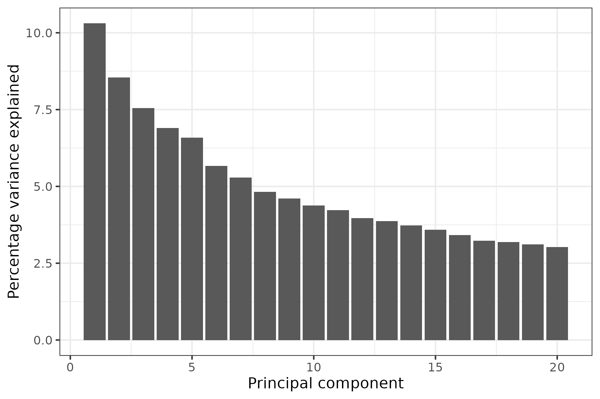

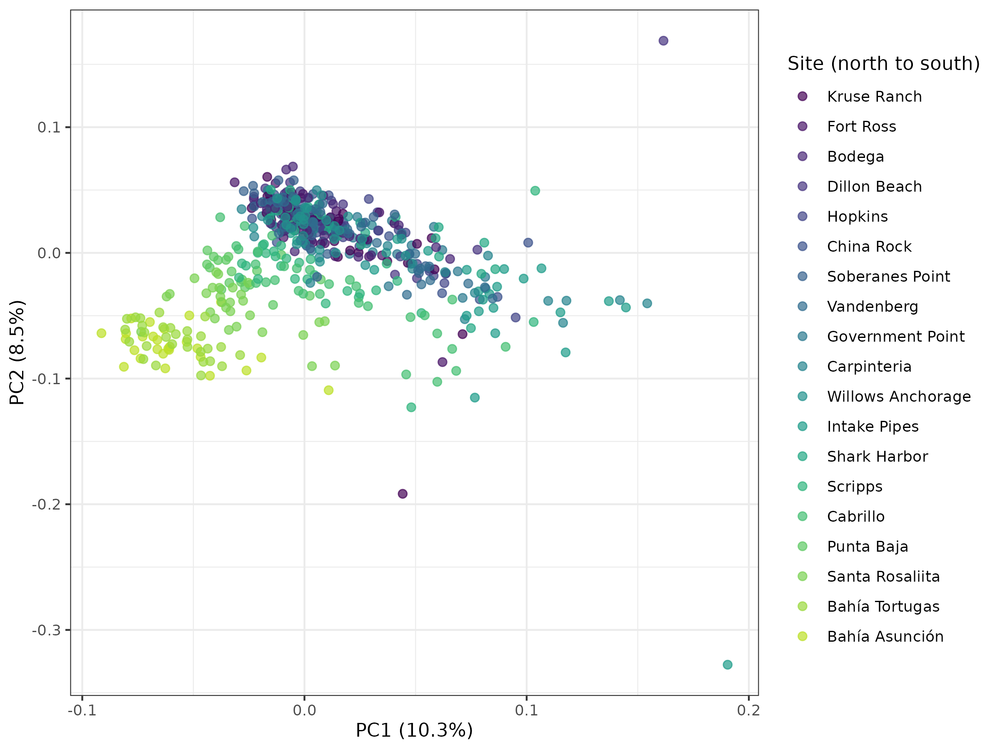

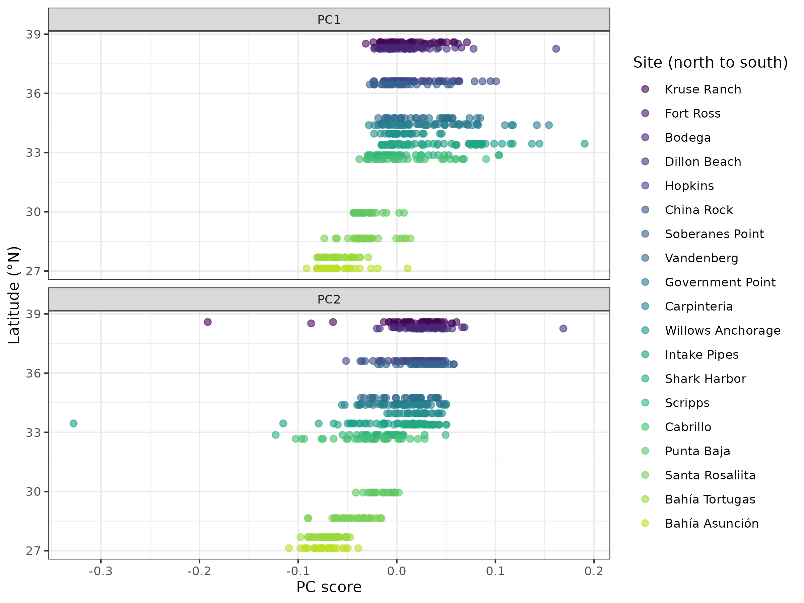

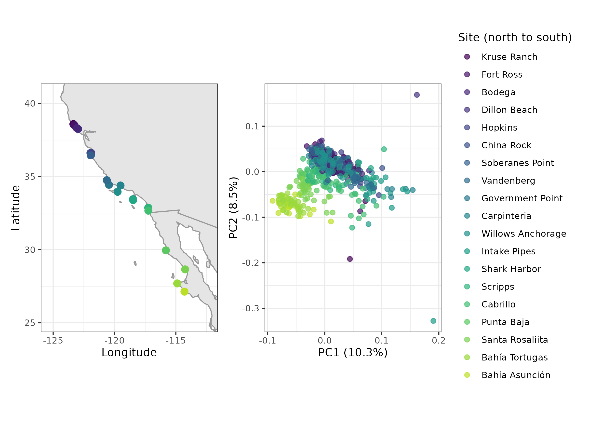

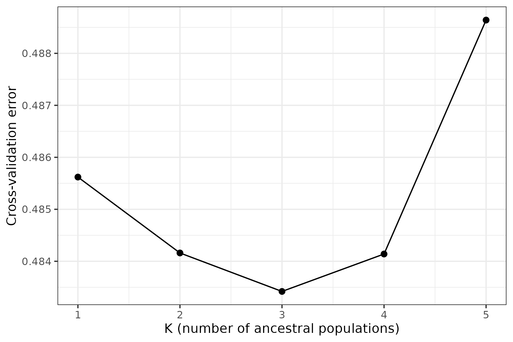

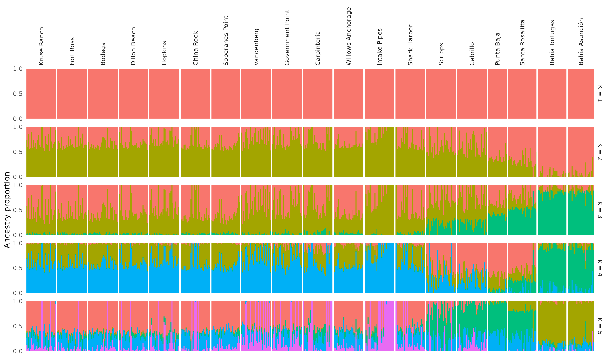

**Notes/Observations**:

-   Lower latitude populations very distinct genetic differentiation

-   K= 2 and 3 - show most distinct populations

**Next steps:**

-   See why 2 southernmost populations are so genetically distinct

## 10. 22 .2026 - Pop Gen Day 4 - Genetic Diversity

-   Plotting nucleotide diversity by latitude

**Working Directory**

`/users/l/d/ldmathew/projects/eco_genomics_2026/population_genomics/mydata`

**Input Files**:

`het`

`pi`

`popmap.txt`

`pops`

`sample_metadata.csv`

`TajD`\
**Output Files**:

`10.22.26_Plotting.R`

**Programs and dependencies**:

`R version 4.5.1`

`vcftools`

**Code**:

`*` copies all data from folder

**Images**:

Nucleotide diversity (Pi) by site

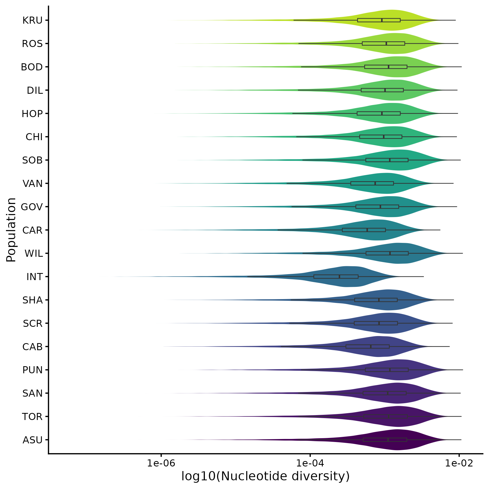

Nucleotide diversity (Pi) vs latitude

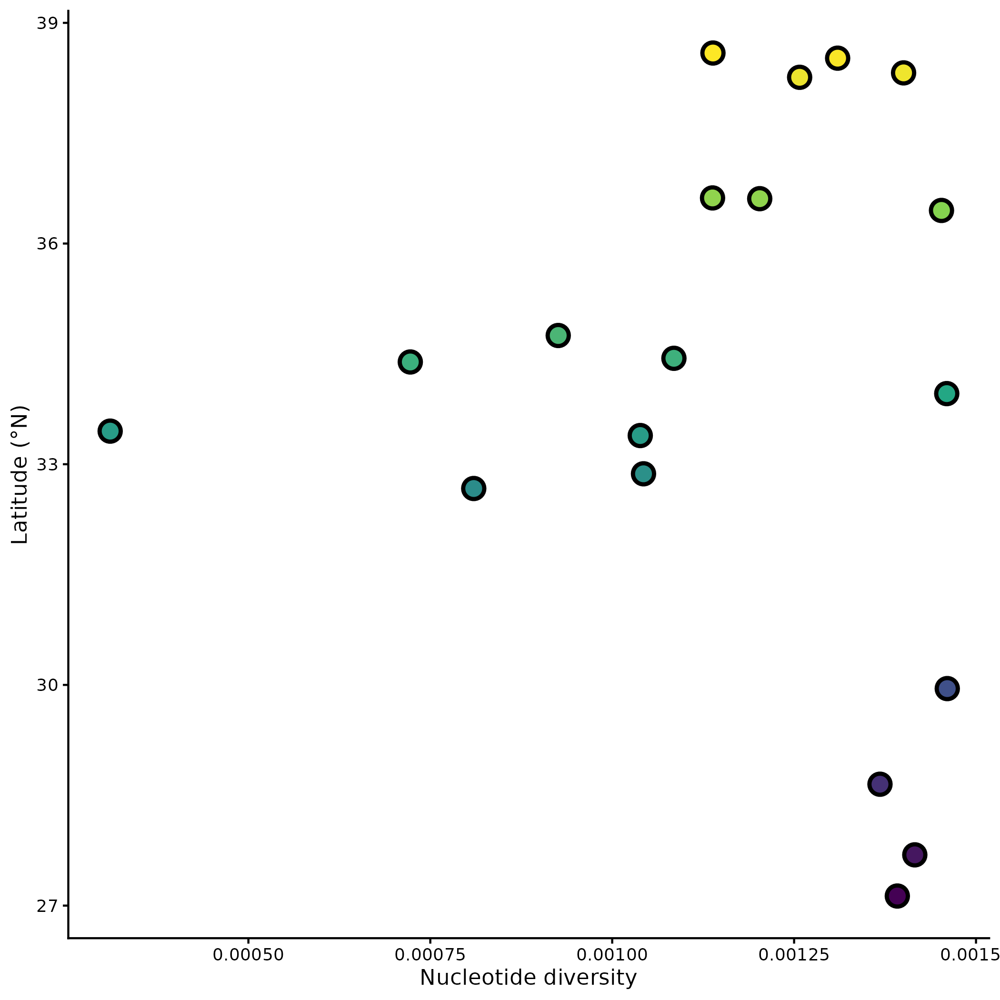

**Notes/Observations**:

Pairwise nucleotide diversity

-   (π) Average number of differences between pairs of sequences

-   Variants at intermediate frequency contribute the most to π

Watterson’s θ (θW)

-   Based on the number of variable sites

-   Every variant counts the same here, however rare it is

-   What we expect genetic diversity to be

Nucleotide diversity plot (pi by site)

-   not seeing a huge pattern

**Next steps:**

-   Tajima's D

------------------------------------------------------------------------

## 10. 27 .2026 - Pop Gen Day 5 - Genetic Diversity (cont) + Selective Signatures

-   Plot Tajima's D

-   Use hetrozygosity to calculate diversity

-   Fixation index (Fst )

**Working Directory**

`/users/l/d/ldmathew/projects/eco_genomics_2026/population_genomics/mydata`

**Input Files**:

`Lottia_gigantea_flt3_sub0.01.vcf.gz`

`popmap.txt`

`sample_metadata.csv`

**Output Files**:

`10.22.26_Plotting.R`

`10.27.26_Fst.R`

**Programs and dependencies**:

`R version 4.5.1`

`vcftools`

**Code**:

`facet_wrap` splits combined plot into multiple plots for each site

`geom_smooth` adds correlation line to plot

**Images**:

Figure 1. Tajima's D by Site

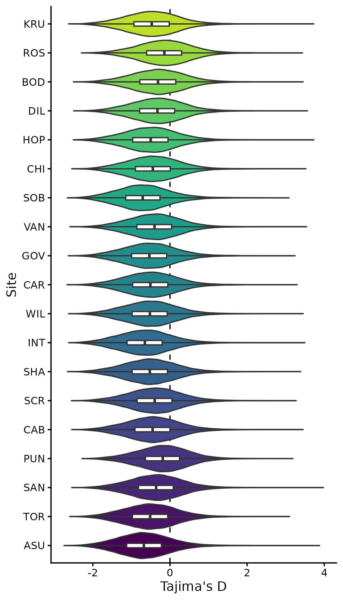{width="440"}

Figure 2. Observed hetrozygosity by site

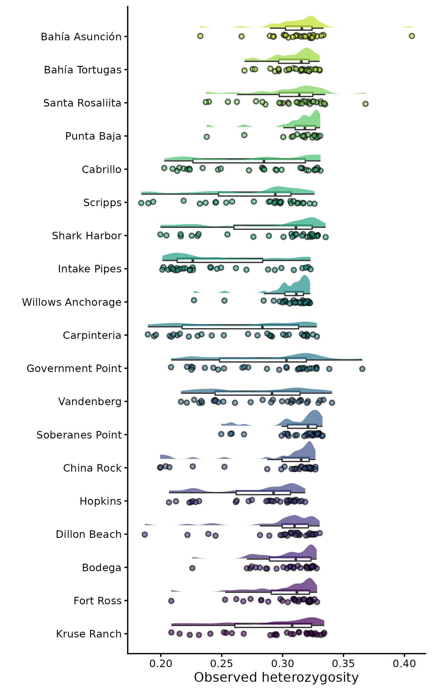{width="566"}

Figure 3. Inbreeding coefficient (F) by site

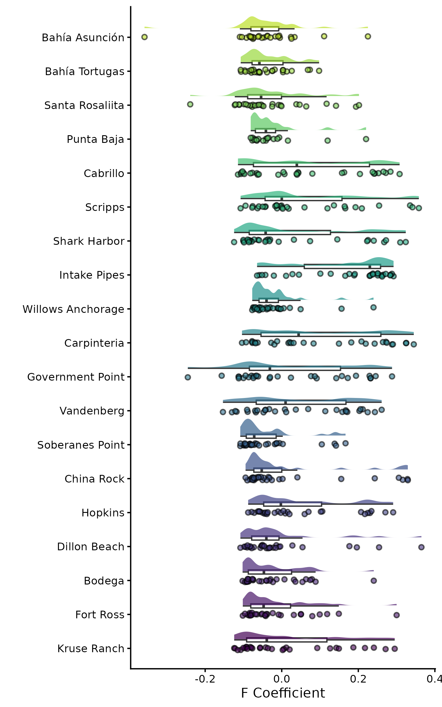{width="503"}

Figure 4. Pairwise FST by latitude

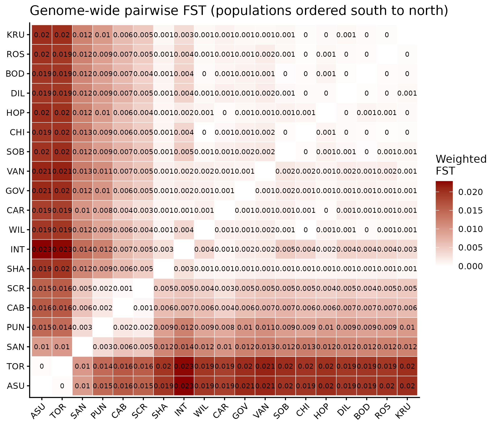{width="518"}

Figure 5. Differentiation by distance

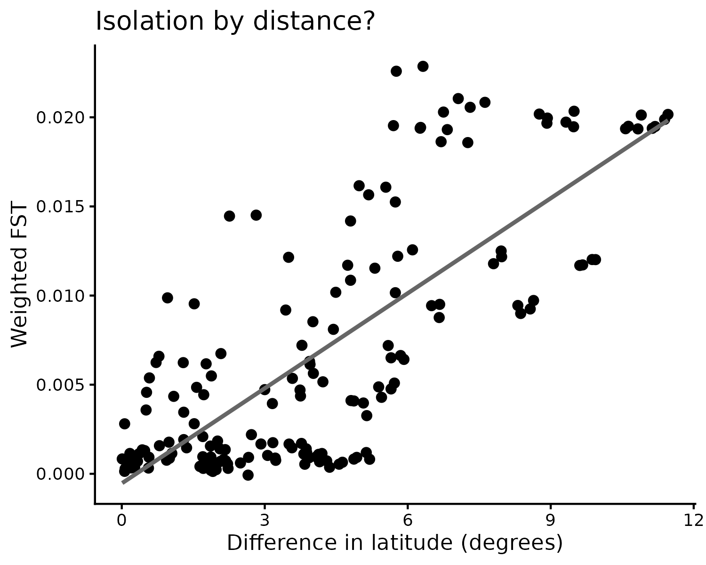{width="488"}

**Notes/Observations**:

-   *Tajima's D*

    -   negative = excess of rare alleles (population undergoing
        positive selection)

    -   positive = excess of higher frequency alleles (population
        undergoing stabilizing selection)

    -   0 = allele frequency is what we'd expect

-   Heterozygosity

    -   Inbreeding coefficient

        -   F = 0 means an individual is as heterozygous as expected

        -   F \> 0 means less heterozygous

            -   more inbreeding

        -   F \< 0 means more heterozygous

            -   less inbreeding

-   Fixation Index (Fst)

    -   0 = no genetic differentiation between the populations

        -   i.e. panmixia

    -   1 = complete fixation

        -   i.e. very genetically divergent populations

    -   populations further apart typically have higher Fst between them

**Next steps:**

-   Plot Fst with Manhattan plot

<!-- -->

-   Tajima's D

------------------------------------------------------------------------

## 10. 29 .2026 - Pop Gen Day 6 - Selective Signatures

-Visualizing BayPass

**Working Directory**

`/users/l/d/ldmathew/projects/eco_genomics_2026/population_genomics/mydata`

**Input Files**:

`Lottia.baypass.env`

`Lottia.baypass.geno`

`Lottia.baypass.pops.txt`

`Lottia.baypass.snps.txt`

`Lottia_bp_covariate.std`

`Lottia_bp_mat_omega.out`

`Lottia_bp_summary_betai_reg.out`

`Lottia_bp_summary_beta_params.out`

`Lottia_bp_summary_pi_xtx.out`

**Output Files**:

`10.29.26_BayPass.R`

**Programs and dependencies**:

`R version 4.5.1`

`vcftools`

**Code**:

**Images**:

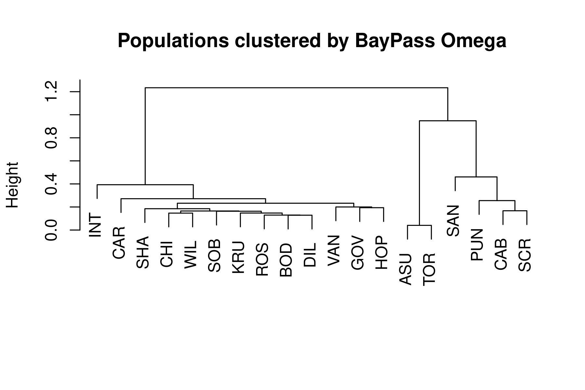{width="357"}

Figure 1. BayPass Omega Tree

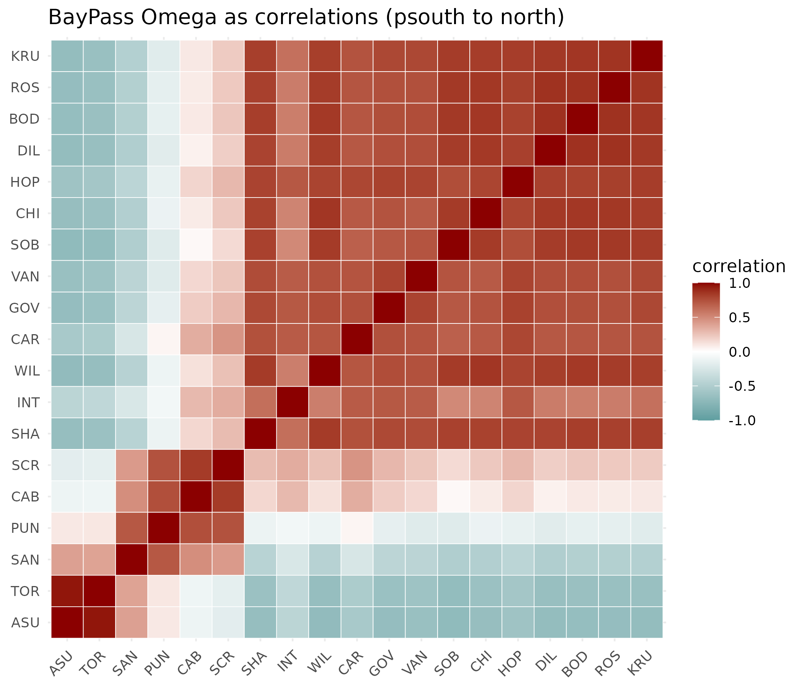{width="478"}

Figure 2. Baypass Omega Plot

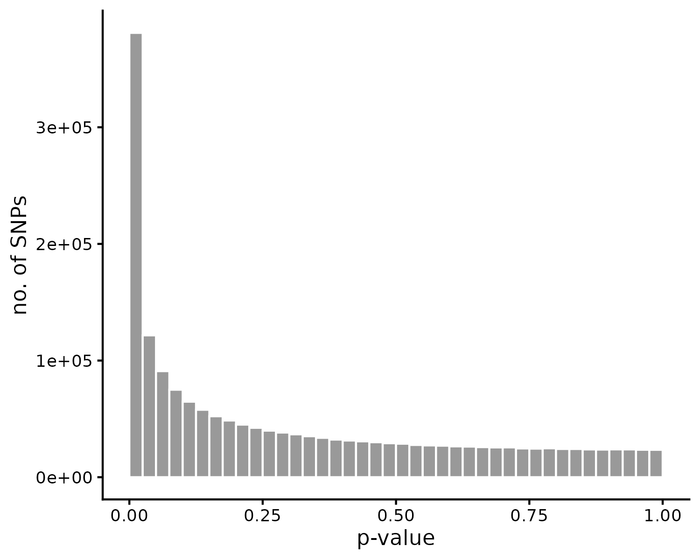{width="504"}

Figure 3. BayPass XTX P vals

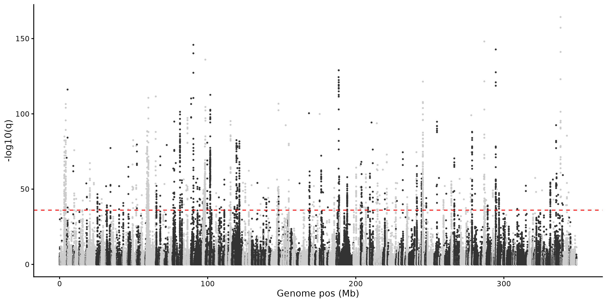{width="543"}

Figure 4. BayPass XTX Scan

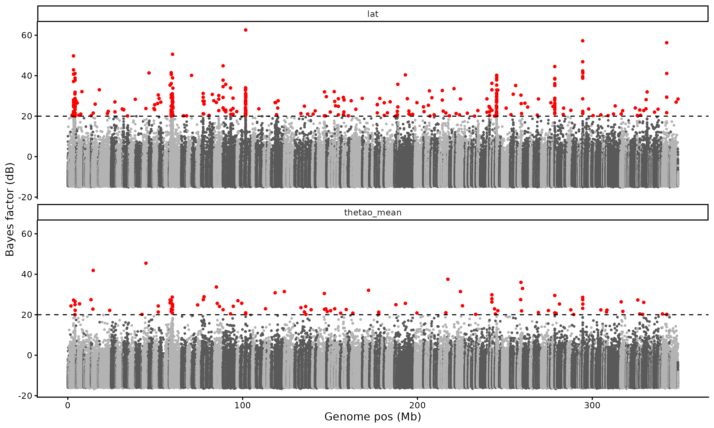{width="508"}

Figure 5. Baypass BF Scan

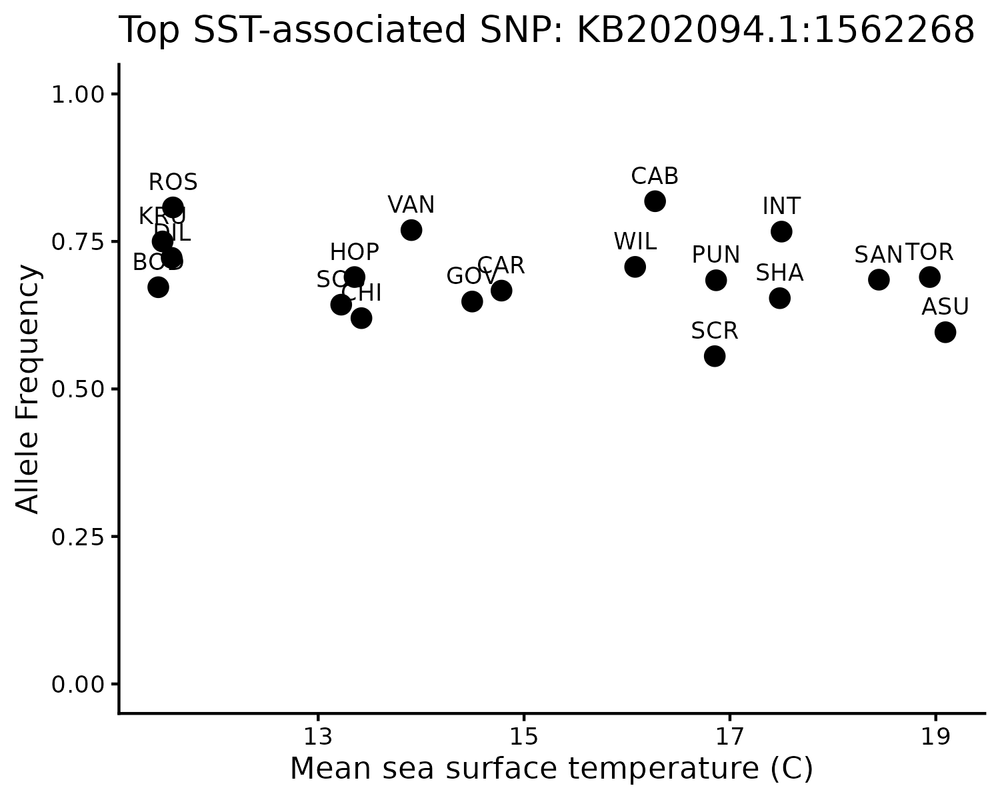{width="534"}

Figure 6. BayPass Top Surface Temperature SNP

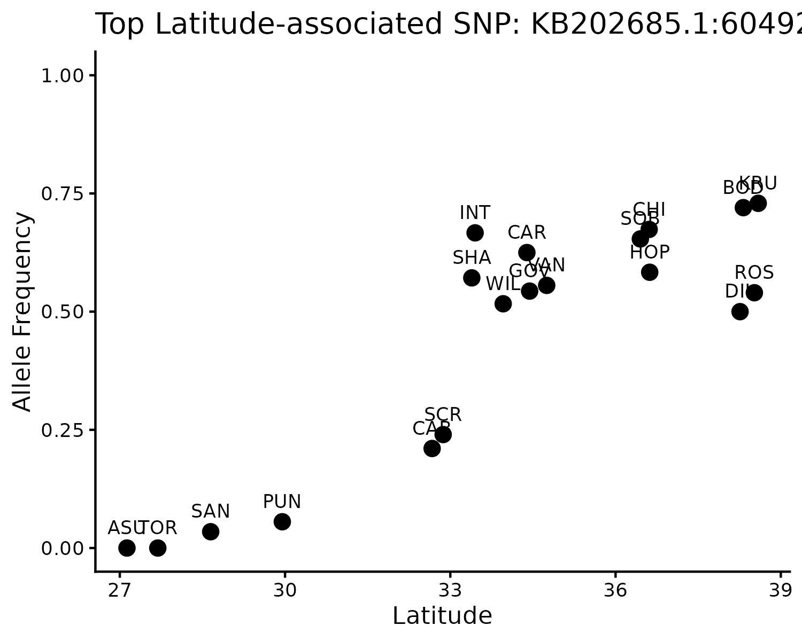{width="504"}

Figure 7. BayPass Top Latitude SNP

**Notes/Observations**:

-   BayPass

    -   Creates matrix of pairwise differences to account for neutral
        variation

        -   Aids in identifying genetic differences due to selection

    -   Typically ran 5 times and averaged across 5 runs

-   Genotype-environment association

    -   Clear pattern for latitude associated SNPs

    -   No clear pattern for sea-surface temp associated SNPs

**Next steps:**

-   Possibly microbiome genomics
-   Homework 2

------------------------------------------------------------------------

## 11. 3 .2026 - Pop Gen Day 7 - Gene Ontology

-   Identify Gene Ontology (GO) terms that are over-represented among
    genes containing outlier SNPs, using topGO
-   Identify the genes near outlier SNPs, and the type of change each
    SNP makes (gene types), using SnpEff output
-   Bring together our results so far to start building a story

**Working Directory**

`/users/l/d/ldmathew/projects/eco_genomics_2026/population_genomics/mydata`

**Input Files**:

`outlier_gene_effects.tsv` - The SnpEff effect of each outlier SNP

`envoutliers.txt` - SNPs with decisive environmental associations (BF \>
20 dB)

`ottia_snp2gene_genic.tsv` - Every SNP that sits inside a gene

`lottia_gene2GO.map` - GO terms assosiated with each gene

`Lottia_bp_xtx_outliers.txt` - Significant outliers from XtX analysis

**Output Files**:

`11.3.26_genefunctions.R`

**Programs and dependencies**:

-   `R version 4.5.1`

-   `R-Studio`

**Scripts**:

`11.3.26_genefunctions.R`

**Code**: `readMappings()` turns the map file into a list with one entry
per gene, each holding that gene’s GO terms. `numChar` allows for entire
GO term to be printed **Notes/Observations**:

-   blastx can be used to compared non-model species translated gene
    sequences to NCBI database protein sequences
-   more outlier SNPs associated with latitude than mean surface temp

*Bringing it all together*

-   Population structure

    -   PCA

        -   Do individuals cluster by site or region?

            -   Individuals cluster more by region/latitude

            -   Less gene flow between isolated southern sites than
                northern sites

    -   ADMIXTURE

        -   How many genetic groups are there, and are individuals of
            mixed ancestry?

        -   There are about 3 groups with more mixed ancestry between
            the northern populations

-   Genetic diversity and signatures of selection

    -   pi and heterozygosity

        -   Which populations are more or less diverse?

            -   Mid-latitude populations have lower nucleotide diversity

    -   Tajima’s D

        -   Are there regions of positive and/or balancing selection?

            -   Northernmost and most southernmost sites show minor
                patterns of positive selection

    -   FST

        -   How different are the populations, and which regions stand
            out?

            -   Two southernmost sites are more related to one another
                than to other sites

            -   Signs of isolation by distance

-   BayPass XtX\*

    -   Which SNPs are more differentiated than the populations
        demography alone predicts?

        -   1822 SNPs are significantly differentiated

        -   XTX outlier analysis shows what stands out from neutral
            structure

-   Genotype × environment associations

    -   BayPass covariate model (BF)

        -   Which SNPs are associated with latitudinal or temperature
            differences?

            -   Top SNP in latitude is associated with latitudinal
                differences

-   Genes of interest

    -   Gene types (SnpEff)

        -   Where are the outlier SNPs relative to genes, and what is
            there potential function?

            -   Intergenic region (may be non-functional or regulatory),
                upstream/downstream gene variant, intron variant

            -   Selection like occuring in regulatory regions rather
                than in protein coding

    -   Gene Ontology

        -   Are the candidate genes enriched for particular functions?

            -   Enriched for homophillic cell adhesion via plasma
                membrane adhesion molecules and maybe cell
                differentiatiation

**Next steps:**

-   HW #2

------------------------------------------------------------------------

## 11. 8 .2026 - Homework 2 - PCA Plotting with 0.5 Threshold

**Working Directory**

`/users/l/d/ldmathew/projects/eco_genomics_2026/population_genomics/mydata`

**Input Files**:

`Lottia_gigantea_pl_flt3.renamed.vcf.gz`

**Output Files**:

`Lg_LD_0.5.eigenvec`

**Programs and dependencies**:

-   `R version 4.5.1`

-   `R-Studio`

**Scripts**:

`Homework_2.R`

**Code**:

```{bash}

# setting file paths for vcf data
DATA_DIR=/path/to/my/directory/PopulationGenomics/mydata
VCF=$DATA_DIR/Lottia_gigantea_pl_flt3.renamed.vcf.gz

# double checking the variables
echo $VCF
ls -lh $VCF

cd $DATA_DIR
pwd

#Linkage Pruning
module load plink
plink --version   # note the version in your notebook

plink --vcf $VCF --double-id --allow-extra-chr \
    --set-missing-var-ids @:# \
    --indep-pairwise 50 10 0.5 \
    --out Lg_LD_0.2
wc -l Lg_LD_0.2.prune.in Lg_LD_0.2.prune.out
  # 983923 SNPs kept
  #837827 SNPs removed
 #1821750 SNPs total
 
#Run PCA on SNPs kept after pruning
plink --vcf $VCF --double-id --allow-extra-chr --set-missing-var-ids @:# \
    --extract Lg_LD_0.5.prune.in \
    --make-bed --pca --out Lg_LD_0.5
```

```{r}
#PCA Plotting in R
library(tidyverse)
setwd ("/users/l/d/ldmathew/projects/eco_genomics_2026/population_genomics/mydata")

####read in the PCA results from plink
# set col_names so they become X1, X2, ...
pca <- read_table("Lg_LD_0.5.eigenvec", col_names = FALSE)

#read .eigenval file into a vector
eigenval <- scan("Lg_LD_0.5.eigenval")

# drop column 2 (identical to col1)
pca <- pca[, -2]

# rename the columns: the first is the sample ID, the rest are PC1, PC2, ...
names(pca)[1] <- "ID"
names(pca)[2:ncol(pca)] <- paste0("PC", 1:(ncol(pca) - 1))

head(pca)

####how much of the variation each PC explains
# convert the eigenvalues to a percentage variance explained (pve)
pve <- data.frame(PC = seq_along(eigenval),
                  pve = eigenval / sum(eigenval) * 100)

# make a folder for PCA figures

pve_plot <- ggplot(pve, aes(PC, pve)) +
  geom_col() +
  labs(x = "Principal component", y = "Percentage variance explained") +
  theme_bw()
pve_plot

OUTDIR="/users/l/d/ldmathew/projects/eco_genomics_2026/population_genomics/myresults/homework2"

ggsave(pve_plot, file=paste0(OUTDIR, "/variance_0.5.png"), width = 6, height = 4)


###PCA PLOT

meta <- read_csv("sample_metadata.csv")
pca <- left_join(pca, meta, by = "ID")

# check every individual matched a row in the metadata: this should print 0
sum(is.na(pca$Site))

# order the sites from north to south, so the legend follows the coast
pca <- pca %>% mutate(Site = fct_reorder(Site, -Latitude))

# axis labels with the % variance explained, e.g. "PC1 (18.7%)"
pc1_lab <- paste0("PC1 (", round(pve$pve[1], 1), "%)")
pc2_lab <- paste0("PC2 (", round(pve$pve[2], 1), "%)")

pca_plot <- ggplot(pca, aes(PC1, PC2, colour = Site)) +
  geom_point(size = 2, alpha = 0.7) +
  scale_colour_viridis_d(end = 0.9) +
  labs(x = pc1_lab, y = pc2_lab, colour = "Site (north to south)") +
  theme_bw()
pca_plot
OUTDIR="/users/l/d/ldmathew/projects/eco_genomics_2026/population_genomics/myresults/homework2"

ggsave(pca_plot, file = paste0(OUTDIR, "/Lg_0.5_pca.png"), width = 8, height = 6)

###LATITUDINAL PLOT
lat_plot <- pca %>%
  select(ID, Site, Latitude, PC1, PC2) %>% ##Select columnns to use
  pivot_longer(c(PC1, PC2), names_to = "PC", values_to = "score") %>%
  ggplot(aes(Latitude, score, colour = Site)) +
  geom_point(size = 2, alpha = 0.6) +
  facet_wrap(~PC, ncol = 1, scales = "free_y") + ##plots PC1 and PC2 seperately
  scale_colour_viridis_d(end = 0.9) + 
  labs(x = "Latitude (°N)", y = "PC score", colour = "Site (north to south)") +
  theme_bw()+
  coord_flip()

OUTDIR="/users/l/d/ldmathew/projects/eco_genomics_2026/population_genomics/myresults/homework2"

ggsave(lat_plot, file = paste0(OUTDIR, "/Lg_0.5_pca_latitude.png"), width = 8, height = 6)

###Map of our sites

library(patchwork) ##combined plots

world <- map_data("world")
sites <- pca %>% distinct(Site, Latitude, Longitude)

map_plot <- ggplot() +
  geom_polygon(data = world, aes(long, lat, group = group),
               fill = "grey90", colour = "grey60") +
  geom_point(data = sites, aes(Longitude, Latitude, colour = Site), size = 3) +
  scale_colour_viridis_d(end = 0.9) +
  # zoom to our sites, with a 2-degree margin all round
  coord_quickmap(xlim = range(sites$Longitude) + c(-2, 2),
                 ylim = range(sites$Latitude) + c(-2, 2)) +
  labs(x = "Longitude", y = "Latitude", colour = "Site (north to south)") +
  theme_bw()

# with patchwork, + puts plots side by side
# we hide the map's legend since PCA's legend already shows the sites
map_pca <- map_plot + theme(legend.position = "none") + pca_plot
map_pca

OUTDIR="/users/l/d/ldmathew/projects/eco_genomics_2026/population_genomics/myresults/homework2"

ggsave(map_pca, file = paste0(OUTDIR, "/Lg_0.5_pca_map.png"), width = 8, height = 6)
```

**Figures:**

Percent variance explained by each PCA

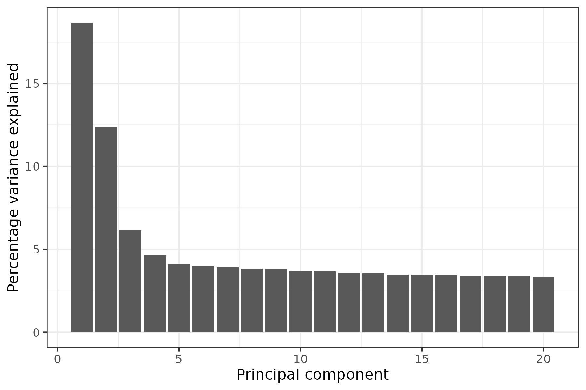

PCA Map showing Latitudinal relationships and PCA Differentiation

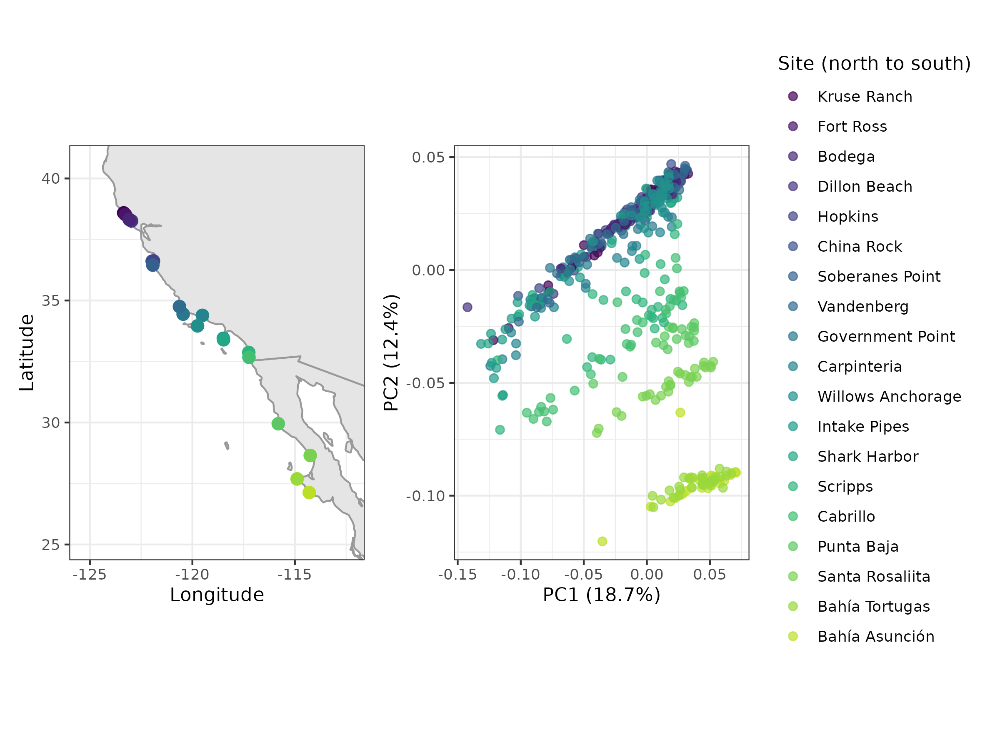

**Notes/Observations**:

-   Pruning threshold set to r\^2\>0.5
-   much greater variance explained with higher threshold (PC1 = \~18%
    as opposed to \~10% with threshold of 0.2)

**Next steps:**

-   run admixture analysis
-   try running LD pruning with even higher threshold (0.8)?
