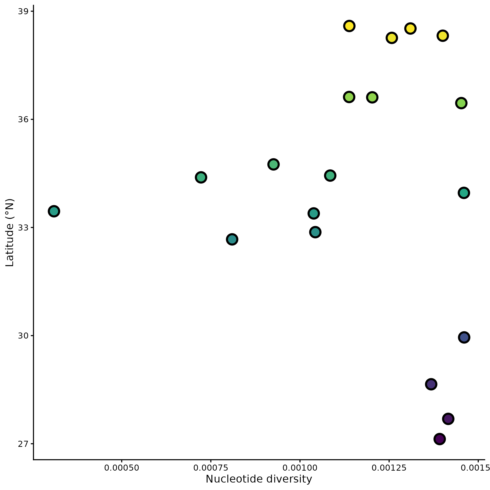
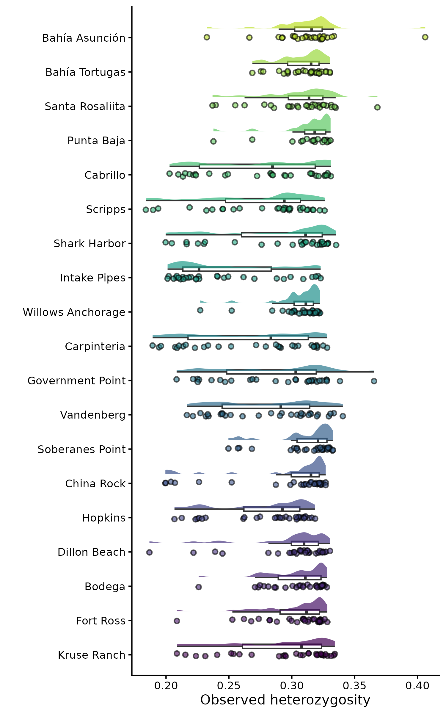
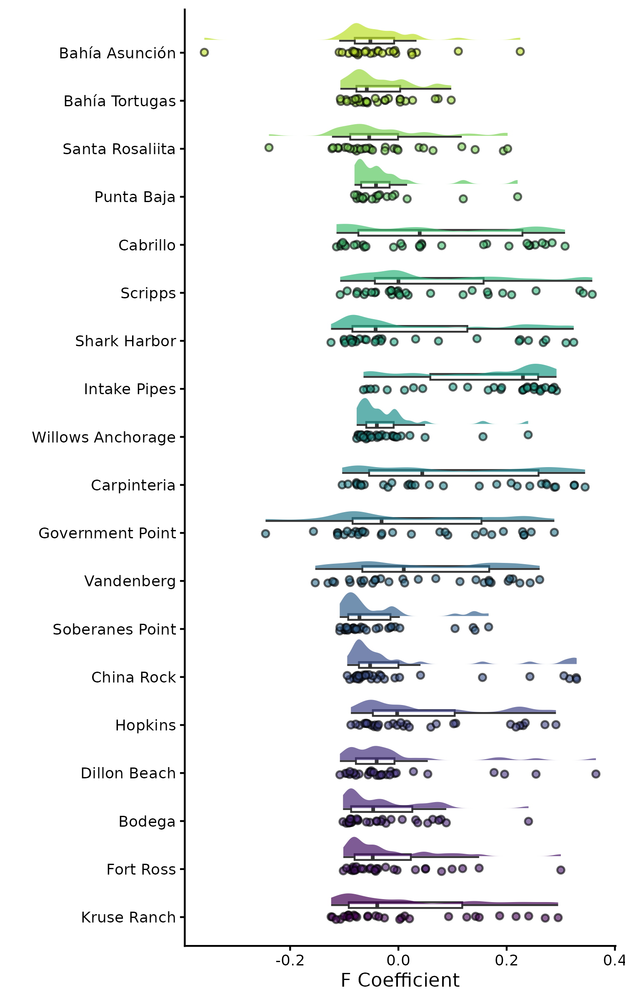
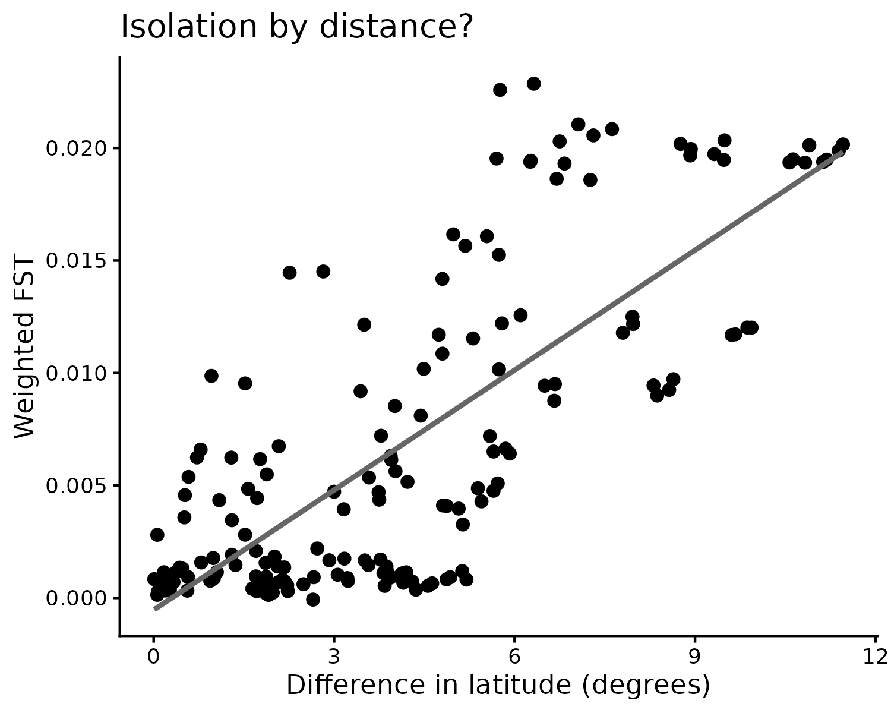
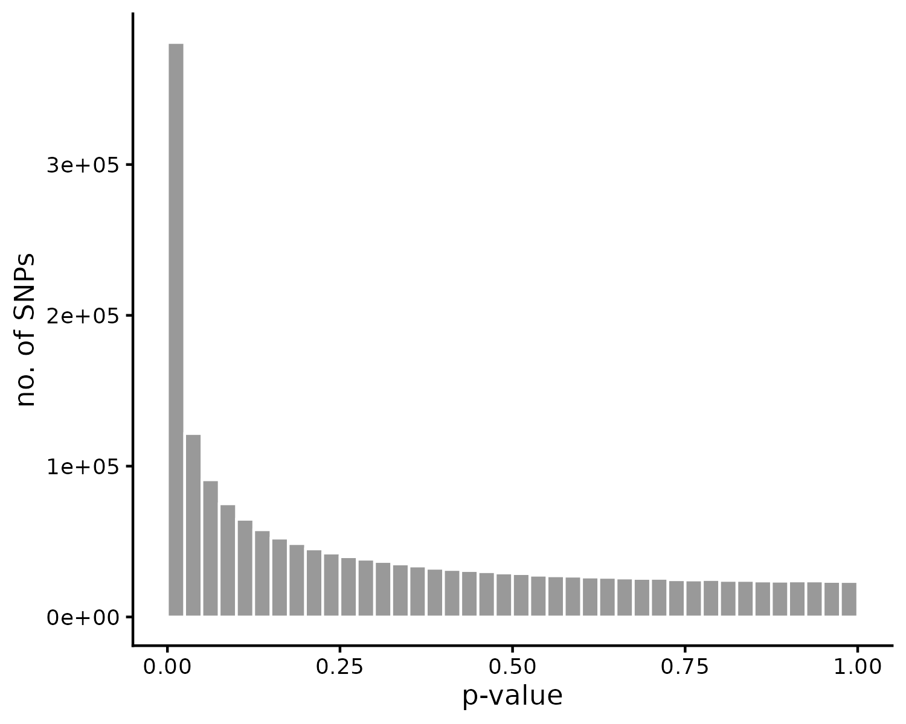
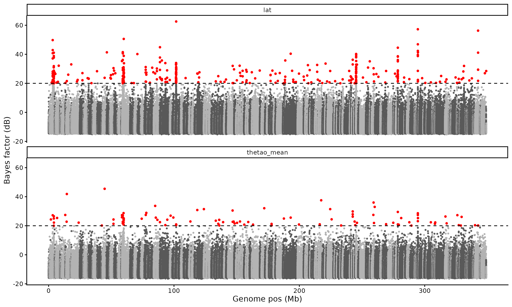
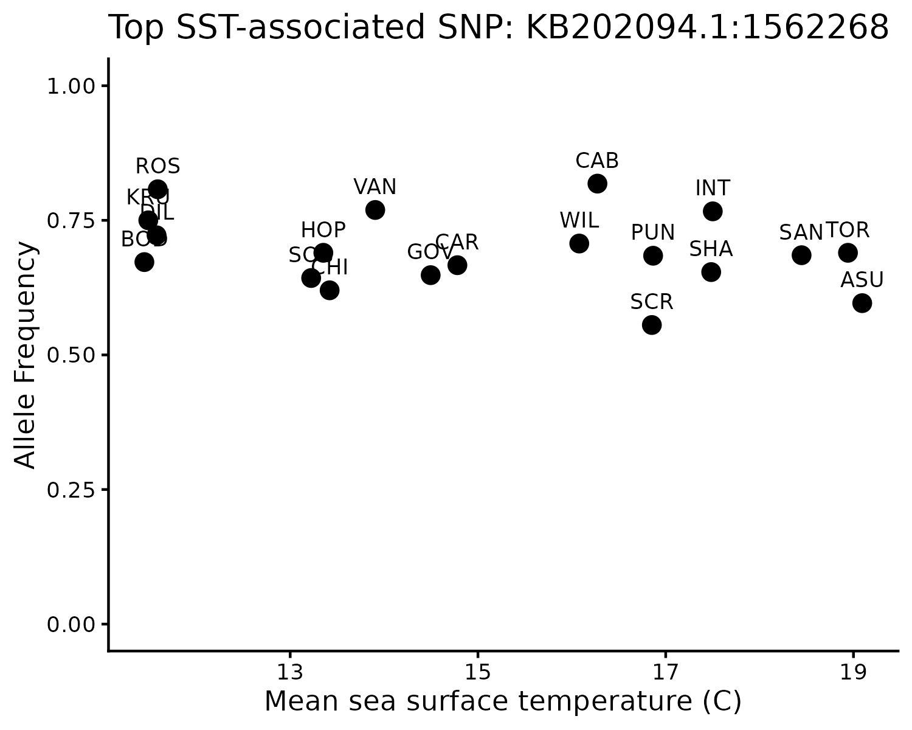

# Population Genomics Notebook

**Course**: Intro to Ecological Genomics - Fall 2026

## **Name**: Lisa Mathews

## month. day .2026 - Pop Gen Day x - Notebook template

**Working Directory**

`/gpfs1/home/l/d/ldmathew/projects/eco_genomics_2026/population_genomics`

**Input Files**:

**Output Files**:

**Programs and dependencies**:

**Notes/Observations**:

**Next steps:**

------------------------------------------------------------------------

## 10. 13 .2026 - Pop Gen Day 1 - Working with VCF Files

-   intro to study system and population genomics
-   added Lottia gigantea data to mydata folder
-   command line coding to look at the VCF data

**Working Directory**

`/users/l/d/ldmathew/projects/eco_genomics_2026/population_genomics/myresults/PopulationStructure`

**Input Files**:

`Lottia_gigantea_biallelic_sub0.01.vcf.gz`

`Lottia_gigantea_biallelic_sub0.01.vcf.gz.csi`

`Lottia_gigantea_biallelic.vcf.gz`

`Lottia_gigantea_biallelic.vcf.gz.tbi`

**Output Files**:

`/gpfs1/home/l/d/ldmathew/projects/eco_genomics_2026/transcriptomics/Population_Genomics_notebook.Rmd`

**Programs and dependencies**:

-   `R version 4.5.1`

-   `R-Studio`

**Scripts**:

`none`

**Code**:

``` r
--versio
```

`--version` shows package version

`--help` prints help page

`grep -v` (“global regular expression print”) searches text for a
pattern and prints the lines that don't match

`control C` cancels an operation

`bcftools` writes every command it runs into the header (in lines
containing Command=), so you can often reconstruct how a file was made
and filtered

**Notes/Observations**:

-   Filtering for:
    -   Biallelic SNPs only
    -   Phred score greater than/equal to 30
    -   Depth of greater than or equal to 3 reads
    -   Sites not missing more than 30% of individuals
    -   Minor allele frequency of 1-5%
-   VCF columns -`#CHROM` Chromosome (for us, scaffold) where the
    variants are found -`POS` Position of the variant on that
    chromosome/scaffold -`ID` Variant identifier; usually . (empty)
    unless you work on human genetics -`REF` Reference allele -`ALT`
    Alternative allele(s) -`QUAL` Phred-scaled quality of the variant
    call -`FILTER` PASS if the site passed all filters, otherwise the
    name of the filter it failed -`INFO` Site-level information, e.g.
    total depth and allele counts; each tag is defined in a ##INFO
    header line -`FORMAT` The order of the individual-level fields that
    follow, e.g. GT:PL:DP:AD:GQ

**Next steps:**

-   Summary statistics with VCF tools

-   First Batch Job

------------------------------------------------------------------------

## 10. 15 .2026 - Pop Gen Day 2 -

-   save VCF stats to mydata through nano

**Working Directory**

`/users/l/d/ldmathew/projects/eco_genomics_2026/population_genomics/myresults/PopulationStructure`

**Input Files**:

`Lottia_gigantea_flt3_sub0.01.vcf.gz`
`Lottia_gigantea_flt3_sub0.01.vcf.gz.tbi`
`Lottia_gigantea_pl_flt3.renamed.vcf.gz`
`Lottia_gigantea_pl_flt3.renamed.vcf.gz.tbi`

**Output Files**:

`vcf_stats.sh`

**Programs and dependencies**:

-   `R version 4.5.1`

-   `R-Studio`

**Code**:

`rm` remove everything from your current directory

```{bash}
nano 5.6.1
#SBATCH --job-name=vcf_stats
#SBATCH --partition=general
#SBATCH --nodes=1
#SBATCH --cpus-per-task=1
#SBATCH --mem=40G
#SBATCH--time=1:00:00
#SBATCH --output=./logs/%x.%j.err
#SBATCH --mail-type=ALL
#SBATCH --mail-user=NETID@uvm.edu
```

`sbatch` -runs a batch job

**Notes/Observations**:

-data was replaced with correct data (flt3)

**Next steps:**

-   Analyze data using PCA and Admixture analysis

------------------------------------------------------------------------

## 10. 20 .2026 - Pop Gen Day 3 - PCA and Admixture

**Working Directory**

`/users/l/d/ldmathew/projects/eco_genomics_2026/population_genomics/mydata`

**Input Files**:

15:33 Lg_LD_0.2.3.P

Lg_LD_0.2.3.Q

Lg_LD_0.2.4.P

Lg_LD_0.2.4.Q

Lg_LD_0.2.5.P

Lg_LD_0.2.5.Q

Lg_LD_0.2.bed

Lg_LD_0.2.bim

Lg_LD_0.2.eigenval

Lg_LD_0.2.eigenvec

Lg_LD_0.2.fam

Lg_LD_0.2.log

Lg_LD_0.2.nosex

Lg_LD_0.2.prune.in

Lg_LD_0.2.prune.out

PopulationStructure

sample_metadata.csv

**Output Files**:

`10.20.26_PCAplot.R`

`10.20.26_Admixture.R`

`vcf_stats.sh`

**Programs and dependencies**:

-R version 4.5.1 (tidyverse)

**Code**:

`DATA_DIR=/users/l/m/ldmathew/projects/eco_genomics_2026/population_genomics/mydata`
makes data dir variable for my data path `echo` checks variable to see
if it holds what we expect

Plink commands:

`--double-id` plink expects a family ID and an individual ID for every
sample, as it was built for pedigree data. We don’t have families, so
this uses the sample name as both `--allow-extra-chr` plink expects
human chromosome names (1–22, X, Y, MT). This tells it to accept other
names, like our scaffolds (e.g. KB201661.1) `--set-missing-var-ids @:#`
Human SNPs usually have names (rs IDs). Ours don’t (the ID column is .),
so this names each SNP scaffold:position (\@ = chromosome, \# =
position), e.g. KB201661.1:333 `--indep-pairwise 50 10 0.2` The pruning
itself: a window of 50 SNPs, moved along 10 SNPs at a time, removing
SNPs until no pair in the window has r² \> 0.2 `--out Lg_LD_0.2` The
prefix for the output files

**Images:**


**Notes/Observations**:

-   Lower latitude populations very distinct genetic differentiation

-   K= 2 and 3 - show most distinct populations

**Next steps:**

-   See why 2 southernmost populations are so genetically distinct

## 10. 22 .2026 - Pop Gen Day 4 - Genetic Diversity

-   Plotting nucleotide diversity by latitude

**Working Directory**

`/users/l/d/ldmathew/projects/eco_genomics_2026/population_genomics/mydata`

**Input Files**:

`het`

`pi`

`popmap.txt`

`pops`

`sample_metadata.csv`

`TajD`\
**Output Files**:

`10.22.26_Plotting.R`

**Programs and dependencies**:

`R version 4.5.1`

`vcftools`

**Code**:

`*` copies all data from folder

**Images**:

Nucleotide diversity (Pi) by site


Nucleotide diversity (Pi) vs latitude



**Notes/Observations**:

Pairwise nucleotide diversity

-   (π) Average number of differences between pairs of sequences

-   Variants at intermediate frequency contribute the most to π

Watterson’s θ (θW)

-   Based on the number of variable sites

-   Every variant counts the same here, however rare it is

-   What we expect genetic diversity to be

Nucleotide diversity plot (pi by site)

-   not seeing a huge pattern

**Next steps:**

-   Tajima's D

------------------------------------------------------------------------

## 10. 27 .2026 - Pop Gen Day 5 - Genetic Diversity (cont) + Selective Signatures

-   Plot Tajima's D

-   Use hetrozygosity to calculate diversity

-   Fixation index (Fst )

**Working Directory**

`/users/l/d/ldmathew/projects/eco_genomics_2026/population_genomics/mydata`

**Input Files**:

`Lottia_gigantea_flt3_sub0.01.vcf.gz`

`popmap.txt`

`sample_metadata.csv`

**Output Files**:

`10.22.26_Plotting.R`

`10.27.26_Fst.R`

**Programs and dependencies**:

`R version 4.5.1`

`vcftools`

**Code**:

`facet_wrap` splits combined plot into multiple plots for each site

`geom_smooth` adds correlation line to plot

**Images**:

Figure 1. Tajima's D by Site

{width="440"}

Figure 2. Observed hetrozygosity by site

{width="566"}

Figure 3. Inbreeding coefficient (F) by site

{width="503"}

Figure 4. Pairwise FST by latitude

{width="518"}

Figure 5. Differentiation by distance

{width="488"}

**Notes/Observations**:

-   *Tajima's D*

    -   negative = excess of rare alleles (population undergoing
        positive selection)

    -   positive = excess of higher frequency alleles (population
        undergoing stabilizing selection)

    -   0 = allele frequency is what we'd expect

-   Heterozygosity

    -   Inbreeding coefficient

        -   F = 0 means an individual is as heterozygous as expected

        -   F \> 0 means less heterozygous

            -   more inbreeding

        -   F \< 0 means more heterozygous

            -   less inbreeding

-   Fixation Index (Fst)

    -   0 = no genetic differentiation between the populations

        -   i.e. panmixia

    -   1 = complete fixation

        -   i.e. very genetically divergent populations

    -   populations further apart typically have higher Fst between them

**Next steps:**

-   Plot Fst with Manhattan plot

<!-- -->

-   Tajima's D

------------------------------------------------------------------------

## 10. 29 .2026 - Pop Gen Day 6 - Selective Signatures

-Visualizing BayPass

**Working Directory**

`/users/l/d/ldmathew/projects/eco_genomics_2026/population_genomics/mydata`

**Input Files**:

`Lottia.baypass.env`

`Lottia.baypass.geno`

`Lottia.baypass.pops.txt`

`Lottia.baypass.snps.txt`

`Lottia_bp_covariate.std`

`Lottia_bp_mat_omega.out`

`Lottia_bp_summary_betai_reg.out`

`Lottia_bp_summary_beta_params.out`

`Lottia_bp_summary_pi_xtx.out`

**Output Files**:

`10.29.26_BayPass.R`

**Programs and dependencies**:

`R version 4.5.1`

`vcftools`

**Code**:

**Images**:

{width="357"}

Figure 1. BayPass Omega Tree

{width="478"}

Figure 2. Baypass Omega Plot

{width="504"}

Figure 3. BayPass XTX P vals

{width="543"}

Figure 4. BayPass XTX Scan

{width="508"}

Figure 5. Baypass BF Scan

{width="534"}

Figure 6. BayPass Top Surface Temperature SNP

{width="504"}

Figure 7. BayPass Top Latitude SNP

**Notes/Observations**:

-   BayPass

    -   Creates matrix of pairwise differences to account for neutral
        variation

        -   Aids in identifying genetic differences due to selection

    -   Typically ran 5 times and averaged across 5 runs

-   Genotype-environment association

    -   Clear pattern for latitude associated SNPs

    -   No clear pattern for sea-surface temp associated SNPs

**Next steps:**

-   Possibly microbiome genomics
-   Homework 2
