# Transcriptomics Notebook

**Course**: Intro to Ecological Genomics - Fall 2026

**Name**: Lisa Mathews

------------------------------------------------------------------------

## 9.15.2026 - Setting up lab notebook and learning markdown

-   Setting up transcriptomics notebook

-   Learn how to take notes in markdown

-   Push notes to github

**Working Directory**

`/gpfs1/home/l/d/ldmathew/projects/eco_genomics_2026/transcriptomics`

**Input Files**:

`None`

**Output Files**:

`/gpfs1/home/l/d/ldmathew/projects/eco_genomics_2026/transcriptomics/transcriptomics_notebook.md`

**Programs and dependencies**:

-   `R version 4.5.1`

-   `R-Studio`

**Scripts**:

`none`

**Code**:

``` r

print("Hello World")
```

**table**:

#/table

| Col1 | Col2 | Col3 |
|------|------|------|
|      |      |      |
|      |      |      |
|      |      |      |

**Image**:

#/image

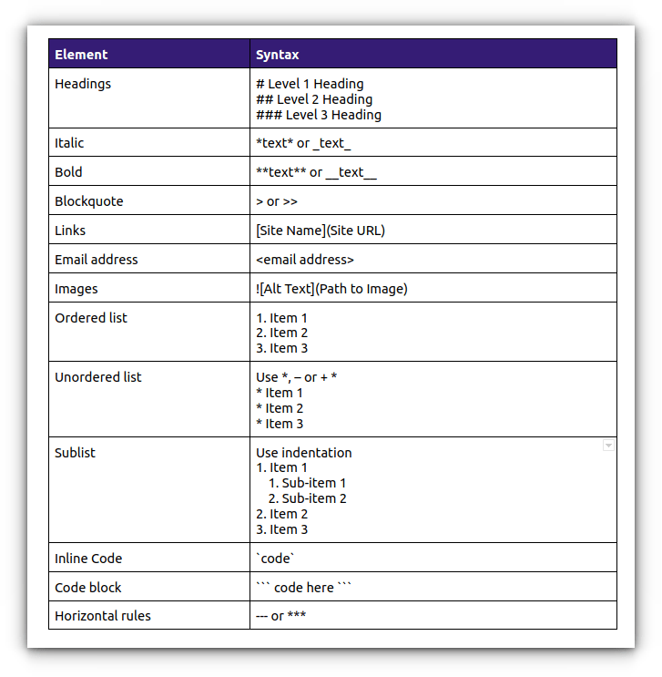

**Notes/Observations**:

-   interpretation blahblahblah

**Next steps:**

-   next project!

------------------------------------------------------------------------

## 9.17.2026 - Introduce Study System

-   Learning how to locate .fq files in biol3990 folder through the VACC shell access

**Output Files**:

`None`

**Programs and dependencies**:

-   `VACC Shell access`

**Code:**

prints directory for transcriptomics folder

```{r}
ll | cd CleanData/ 
```

unzips big file and shows first 4 lines (avoids overloading VACC)

```{r}
zcat filename | head -n 4/
```

counts number of lines in the file

```{r}
zcat filename | wc -l
```

**Next steps:**

test for differential expression with fastq data

------------------------------------------------------------------------

## 9.22.2026 - Day 3 of Transcriptomics

Today we set up our R working file to look at A. hutsonica DESeq data

-   Got set up with your Rstudio working environment, repo, data files, and script

-   Continued working in .rmd file to keep your differential gene expression analysis notes together and annotated

-   Imported the counts matrix into DESeq2

-   Visualized reads and variation

-   Visualized global variation in gene expression using Principal Component Analysis (PCA)

**Working Directory**

`/gpfs1/home/l/d/ldmathew/projects/eco_genomics_2026/transcriptomics/myscripts`

**Input Files**:

`salmon.isoform.counts.matrix.filteredAssembly`

`ahud_samples_R.txt`

**Output Files**:

`/myresults/PCA_allGens.png` `ahud_DESeq2 inclass.R`

**Programs and dependencies**:

-   `R version 4.5.1`

-   `R-Studio`

**Scripts**:

`ahud_DESeq2 inclass.R`

**Code**:

Remove all genes with counts \< 15 in more than 75% of samples (genes w/ too few reads)

```{r}
dds <- dds[rowSums(counts(dds) >= 15) >= 28,]
```

Runs DESeq function

```{r}
dds <- DESeq(dds)

Log 2 (n+1) and variance stabalizing transformation graphs

ntd <- normTransform(dds)
meanSdPlot(assay(ntd))

vsd <- vst(dds, blind=FALSE)
meanSdPlot(assay(vsd))
```

Heatmap of sample distance/dissimilarity

```{r}
sampleDists <- dist(t(assay(vsd)))

library("RColorBrewer")
sampleDistMatrix <- as.matrix(sampleDists)
rownames(sampleDistMatrix) <- paste(vsd$line, vsd$generation, sep="-")
colnames(sampleDistMatrix) <- NULL
colors <- colorRampPalette( rev(brewer.pal(9, "Blues")) )(255)
pheatmap(sampleDistMatrix,
         clustering_distance_rows=sampleDists,
         clustering_distance_cols=sampleDists,
         col=colors)
```

Cluster tree that looks for outliers

```{r}
sampleTree <- hclust(dist(sampleDists), method="average")}
plot(sampleTree, main="Sample clustering to detect outliers", sub="", xlab="",cex.lab=1.5, cex.axis=1.5, cex.main=2)
```

Transform the data for plotting using variance stabilization

```{r}
vsd <- vst(dds, blind=FALSE)

pcaData <- plotPCA(vsd, intgroup=c("line","generation"), returnData=TRUE) percentVar <- round(100 * attr(pcaData,"percentVar"))

ggplot(pcaData, aes(PC1, PC2, color=line, shape=generation)) + geom_point(size=3) + xlab(paste0("PC1: ",percentVar[1],"% variance")) + ylab(paste0("PC2: ",percentVar[2],"% variance")) + coord_fixed(
```

... Then made lots of PCA plots using ggplot

**PCA Plots:**

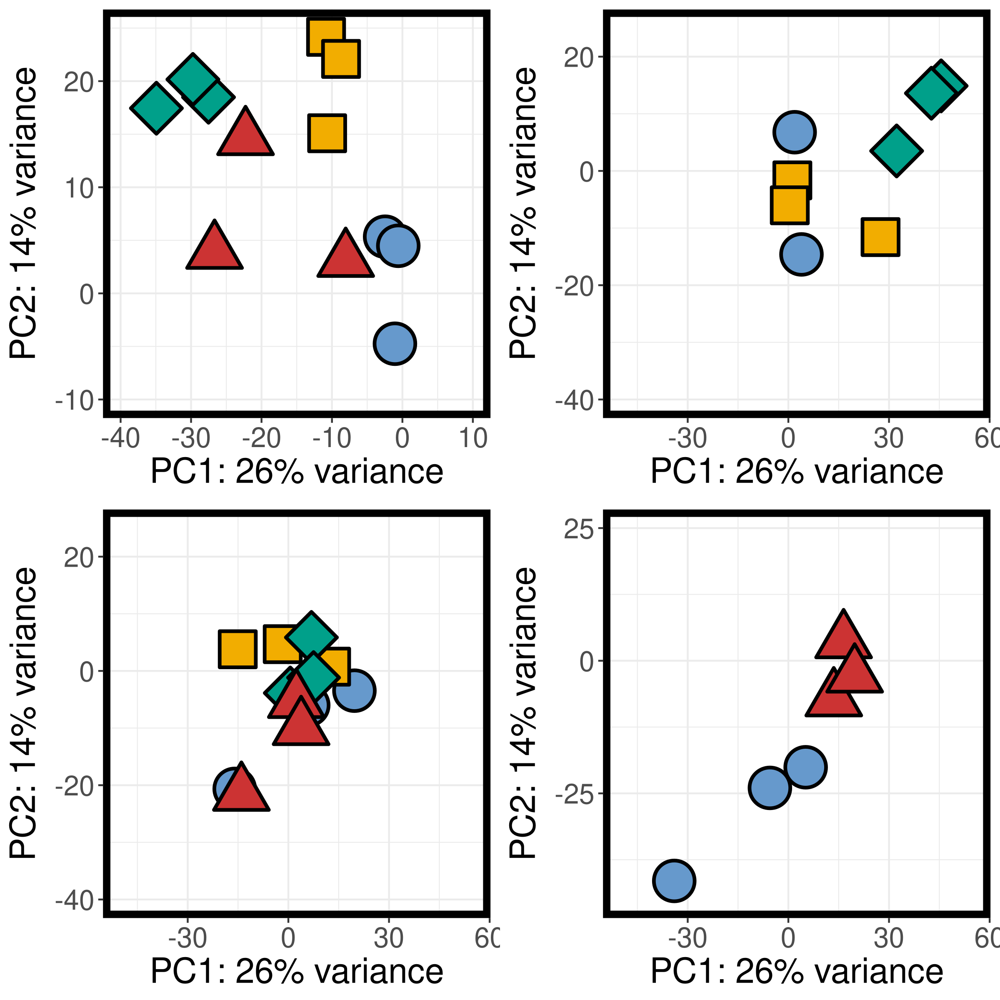

**Notes/Observations**:

-   PCA:
    -   After 4 generations, all treatments basically synced physiology
    -   After 11 generations, OWA shifted physiology

**Next steps:**

-   Explore the data with more visualizations

-   Plot individual genes

-   Run another model to focus within generation F0 between treatments

-   Make a heat map of the top differentially expressed genes \## 9.24.2026 - Reviewing R coding and Bash Basics

-   Going over bash commands used last week

-   Reviewing A.hudsonica code

**Working Directory**

`/gpfs1/home/l/d/ldmathew/projects/eco_genomics_2026/transcriptomics/myscripts`

**Input Files**:

`None`

**Output Files**:

`/gpfs1/home/l/d/ldmathew/projects/eco_genomics_2026/transcriptomics/transcriptomics_notebook.md`

**Programs and dependencies**:

-   `R version Tidyverse 4.5.1`

-   `R-Studio`

**Scripts**:

`ahud_DESeq2 inclass.R`

**Code**:

**bash** Print working directory `pwd`

Change working directory `cd`

Move back directory `..`

Home directory shortcut `~`

List long (includes file info) `ll`

Print all code entered/changed during session `history`

Copy `cp`

Remove `rm` \*This is permanent!

Unzip file (prints whole file) `zcat`

**ahud working script**

Shows output dimensions

``` r
dim()
```


**Notes**:

-   Much of A.hud code included in 9-22 notebook entry
-   All bash commands pertain to terminal coding

**Next steps:**

-   Continue processing + visualizing A.hud data

------------------------------------------------------------------------

## 9.24.2026 - Reviewing R coding and Bash Basics

-   Going over bash commands used last week
-   Reviewing A.hudsonica code

**Working Directory**

`/gpfs1/home/l/d/ldmathew/projects/eco_genomics_2026/transcriptomics/myscripts`

**Input Files**:

`None`

**Output Files**:

`/gpfs1/home/l/d/ldmathew/projects/eco_genomics_2026/transcriptomics/transcriptomics_notebook.md`

**Programs and dependencies**:

-   `R version Tidyverse 4.5.1`

-   `R-Studio`

**Scripts**:

`ahud_DESeq2 inclass.R`

**Code**:

**bash** Print working directory `pwd`

Change working directory `cd`

Move back directory `..`

Home directory shortcut `~`

List long (includes file info) `ll`

Print all code entered/changed during session `history`

Copy `cp`

Remove `rm` \*This is permanent!

Unzip file (prints whole file) `zcat`

**ahud working script**

Shows output dimensions

``` r
dim()
```


**Notes**:

-   Much of A.hud code included in 9-22 notebook entry
-   All bash commands pertain to terminal coding

**Next steps:**

-   Continue processing + visualizing A.hud data

------------------------------------------------------------------------

## 9.29.2026 - Day 4: Differential gene expression analysis

-   Analyzed and visualized the counts matrix using a simplied data set (just generation F0)

-   Understanding a contrast and up- versus down-regulation?

-   Learn how to make the various common types of differential gene expression visualizations (ie. Volcano plot, Euler diagram, Heatmap, etc.)

**Working Directory**

`/gpfs1/home/l/d/ldmathew/projects/eco_genomics_2026/transcriptomics/mydata`

**Input Files**:

`salmon.isoform.counts.matrix.filteredAssembly`

`ahud_samples_R.txt`

**Output Files**:

`9.29.26_ahud_DESeqpt2.R`

**Programs and dependencies**:

-   `R version Tidyverse 4.5.1`

-   `R-Studio`

**Scripts**:

`9.26.26_ahud_DESeqpt2.R`

**Code**:

`setwd("~/projects/eco_genomics_2026/transcriptomics/mydata")`

Sets our working directory

`class(volcano_df)`

Tells r what kind of data "volcano_df" holds

`%in%`

This asks, “is this member of that group?”

**Plots**:

Figure 1. Plot of specific top interaction gene TRINITY_DN30_c0_g2::TRINITY_DN30_c0_g2_i1::g.130::m.130

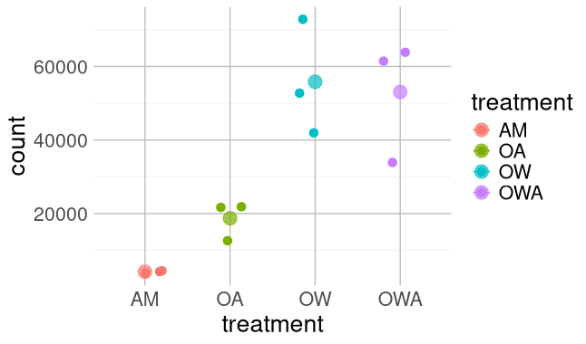{width="445"}

Figure 2. MA plot of log fold change in OW vs AM. Blue indicates significance whereas grey is insignificant.

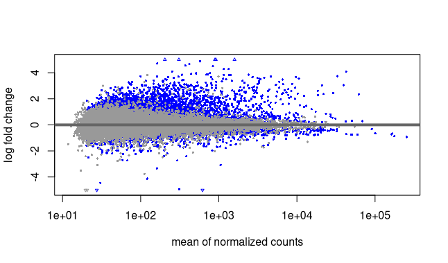{width="388"}

Figure 3. Volcano plot of OW vs AM. Red indicates up-regulations while blue indicates down-regulation.

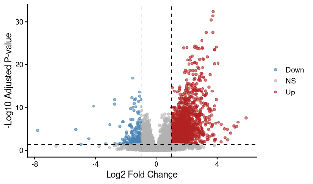{width="430"}

Figure 4. Heat map of top 20 expressed genes sorted by p-value

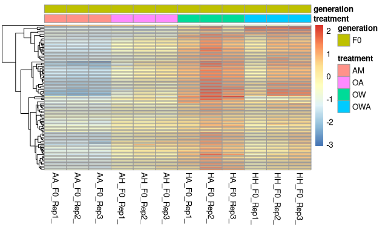{width="437"}

Figure 5. Venn Euler diagram for OWA, OA, and OW.

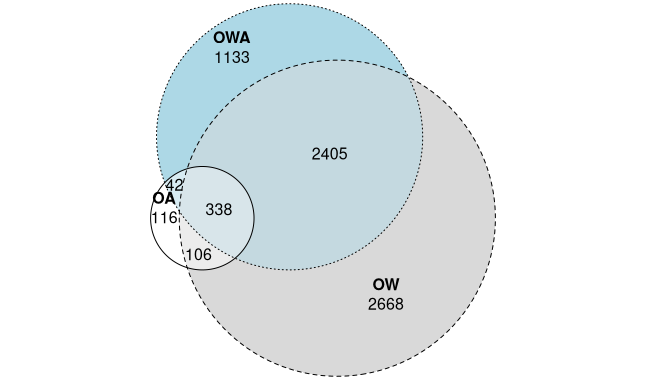{width="525"}

Figure 6. Upset Plot for OWA, OA, and OW.

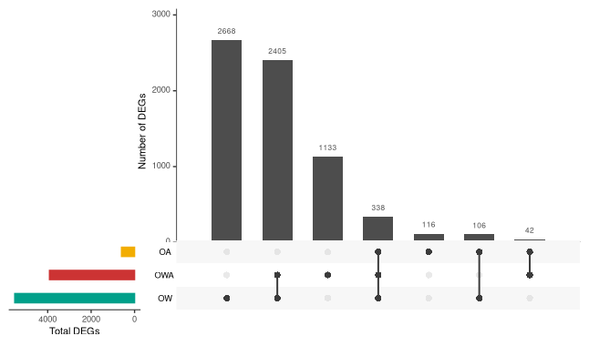{width="418"}

**Observations**:

-   Out of significant results:

    -   9.3% are up-regulated in OWA, 14% in OW, and 1.7% in OA

    -   6.2% are down-regulated in OWA, 8.1% in OW, and 0.7% in OA

-   MA plot showed a majority up-regulation of genes in OW vs AM

-   Volcano plot of OW vs AM showed same results as MA plot, but also greater significance in up-regulated genes than down-regulated genes

    -   Positive log fold change is up-regulation, opposite is down-regulation

-   Upset plot shows \# of deferentially expressed genes, sorted by combinations between groups

**Next steps:**

-   DGEA wrap up

-   GO enrichment analysis

-   WGCNA analyses

------------------------------------------------------------------------

## 10.01.2026 - DGEA wrap up and Scatterplotting

-   Scatter plot was used to compare expression responses to OW relative to OWA (each vs. AM control)

-   Color coding plot based on significance

**Working Directory:**

`~/projects/eco_genomics_2026/transcriptomics/mydata`

**Input Files**:

`salmon.isoform.counts.matrix.filteredAssembly`

`ahud_samples_R.txt`

**Output Files**:

`10.01.26_ahud_DESeqpt3.R`

**Programs and dependencies**:

-   `R version tidyverse 4.5.1`

-   `R-Studio`

**Scripts**:

`10.01.26_ahud_DESeqpt3.R`

**Code**:

`alpha ()` changes opacity of ggplot dots

`annotate ()` adds text to a figure

*Tidyverse functions*:

`filter()` to remove rows

`mutate()` to add a new variable

`case_when()` to classify genes into categories

`arrange()` to sort the rows

**Images:**


**Notes/Observations**:

-   Log2 Fold Change is the change in gene regulation (up or down) between groups

**Next steps:**

-   Go enrichment and WGCNA analyses

------------------------------------------------------------------------

## 10.06.2026 - GO and maybe WGCNA analyses

-   Understand how gene ontology (GO) functional enrichment analysis works
-   Perform GO analyses using TopGO
-   Perform and understand Weighted Gene Correlation Network Analysis ((WGCNA))

**Working Directory:**

`~/projects/eco_genomics_2026/transcriptomics/mydata`

**Input Files**:

Go Analysis

`transcript_universe.csv`

`trinotate_annotation_GOblastx_forTopGO.txt`

WGCNA

`bwnet.rds`

`Ahud_trait_data.txt`

`salmon.isoform.counts.matrix.filteredAssembly`

**Output Files**:

`10.06.26_ahud_GO.R`

`10.06.26_ahud_WGCNA.R`

**Programs and dependencies**:

-   `R version tidyverse 4.5.1`

-   `R-Studio`

**Scripts**:

`10.06.26_ahud_GO.R`

`10.06.26_ahud_WGCNA.R`

**Code**:

`write.csv` creates saved results files with the abbreviated trinity ids

`cat()` combine R objects, convert them to character strings, and print them directly to the console or write them to a file

`cp` copied .txt file from class directory to other directory

`cd` change directory command in terminal

`list()` creates list

`go$minusLogP` flips the log sign so that the most significant things appear at top rather than bottom of graph

```{r}
size = "proportion Significant\nGenes"
```

\^bubble plot variation that makes it so that "bubbles" are a proportion of significance

**Images:**

Figure 1. GO Enrichment Analysis for OWA vs AM

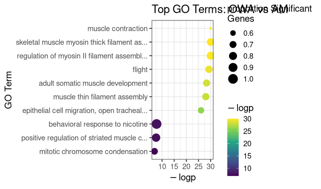{width="626"}

Figure 2. GO Enrichment Analysis for OW vs AM

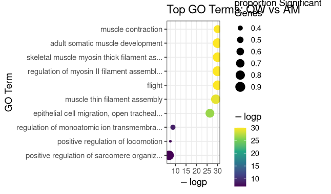

Figure 3. GO Enrichment Analysis for OA vs AM

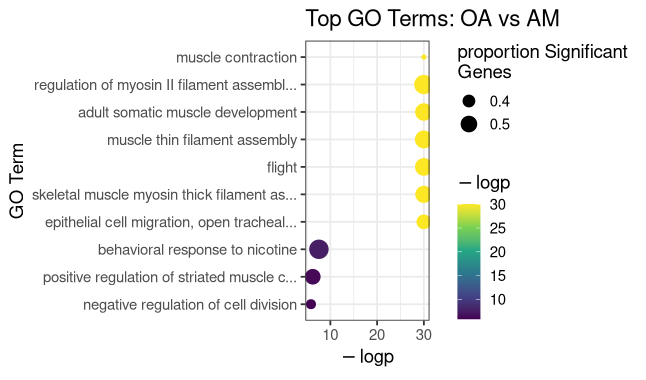

Figure 4. Gene cluster Dendrogram to Detect Outlier Samples


**Notes/Observations**:

-   "flying" GO term may be associated with swimming in cephalopods

    -   GO terms are not always indicative of gene behavior in this specific organism

-   Useful gene ontology term search website to find other genes and mechanisms associated with GO outputs <https://www.informatics.jax.org/>

**Next steps:**

-   Finish WGCNA analysis

-   Homework #1

------------------------------------------------------------------------

## 10.08.2026 - PCA plotting for HW 1

-   Create DESeq2 objects for treatment + generation
-   Plot PCA analysis for treatment + generation

**Working Directory:**

`~/projects/eco_genomics_2026/transcriptomics/mydata`

**Input Files**:

`salmon.isoform.counts.matrix.filteredAssembly`

**Output Files**:

`Homework_1.R`

**Programs and dependencies**:

-   `R version tidyverse 4.5.1`

-   `R-Studio`

**Scripts**:

`Homework_1.R`

**Code**:

```{r}
countsTable <- read.table("salmon.isoform.counts.matrix.filteredAssembly", header=TRUE, row.names=1)

#Round counts matrix for DESeq2
countsTableRound <- round(countsTable)

#Import sample descriptions table
conds <- read.delim("ahud_samples_R.txt", header=TRUE, stringsAsFactors = TRUE, row.names=1)

#normalize counts table data
dds <- DESeqDataSetFromMatrix(countData = countsTableRound, colData=conds, 
                              design= ~ treatment)
dim(dds)
# 67916 genes and 38 samples total

#filter so that there are at least 15 counts per gene in 75% of samples
dds <- dds[rowSums(counts(dds) >= 15) >= 28,]

dim(dds)
## Subset the DESeqDataSet to FO
dds_F0 <- subset(dds, select = generation == 'F0')
# 25260 genes and 12 samples in F0

# Perform DESeq2 analysis on the subset
dds_F0 <- DESeq(dds_F0)

#Check DESeq2 results for F0
resultsNames(dds_F0)

#Name FO OWA vs AM result
F0_res_OWAvsAM <- results(dds_F0, name="treatment_OWA_vs_AM", alpha=0.05)
#9.3% are up-regulated and 6.2% are down-regulated

#Name F0 OW vs AM
F0_res_OWvsAM <- results(dds_F0, name="treatment_OW_vs_AM", alpha=0.05)
#14% are up-regulated and 8.1% are down-regulated

#Name F0 OA vs AM
F0_res_OAvsAM <- results(dds_F0, name="treatment_OA_vs_AM", alpha=0.05)
#1.7% are up-regulated and 0.7% are down-regulated


## Subset the DESeqDataSet to F4
dds_F4 <- subset(dds, select = generation == 'F4')
dim(dds_F4)
# 25260 genes and 12 samples in F4

# Perform DESeq2 analysis on the subset
dds_F4 <- DESeq(dds_F4)

#Check DESeq2 results for F4
resultsNames(dds_F4)

#Name F4 OWA vs AM result
F4_res_OWAvsAM <- results(dds_F4, name="treatment_OWA_vs_AM", alpha=0.05)
summary(F4_res_OWAvsAM)
#0.41% are up-regulated and 0.55% are down-regulated

#Name F4 OW vs AM
F4_res_OWvsAM <- results(dds_F4, name="treatment_OW_vs_AM", alpha=0.05)
summary(F4_res_OWvsAM)
#0.44% are up-regulated and 0.17% are down-regulated

#Name F4 OA vs AM
F4_res_OAvsAM <- results(dds_F4, name="treatment_OA_vs_AM", alpha=0.05)
summary(F4_res_OAvsAM)
#0.42% are up-regulated and 0.2% are down-regulated

#plot individual genes to see if the statistics are behaving as we expect for F0
d <-plotCounts(dds_F0, gene="TRINITY_DN30_c0_g2::TRINITY_DN30_c0_g2_i1::g.130::m.130", intgroup = (c("treatment")), returnData=TRUE)
d
p <-ggplot(d, aes(x=treatment, y=count, color=treatment)) + 
  theme_minimal() + theme(text = element_text(size=20), panel.grid.major=element_line(colour="grey"))
p <- p + geom_point(position=position_jitter(w=0.2,h=0), size=3)
p <- p + stat_summary(fun = mean, geom = "line")
p <- p + stat_summary(fun = mean, geom = "point", size=5, alpha=0.7) 
p
#plot individual genes to see if the statistics are behaving as we expect for F4
j <-plotCounts(dds_F4, gene="TRINITY_DN30_c0_g2::TRINITY_DN30_c0_g2_i1::g.130::m.130", intgroup = (c("treatment")), returnData=TRUE)
j
k <-ggplot(j, aes(x=treatment, y=count, color=treatment)) + 
  theme_minimal() + theme(text = element_text(size=20), panel.grid.major=element_line(colour="grey"))
k <- k + geom_point(position=position_jitter(w=0.2,h=0), size=3)
k <- k + stat_summary(fun = mean, geom = "line")
k <- k + stat_summary(fun = mean, geom = "point", size=5, alpha=0.7) 
k

###PCAplot###
#transform the data for plotting using variance stabilization
vsd <- vst(dds, blind=FALSE)

pcaData <- plotPCA(vsd, intgroup=c("treatment","generation"), returnData=TRUE)
percentVar <- round(100 * attr(pcaData,"percentVar"))

ggplot(pcaData, aes(PC1, PC2, color=treatment, shape=generation)) +
  geom_point(size=3) +
  xlab(paste0("PC1: ",percentVar[1],"% variance")) +
  ylab(paste0("PC2: ",percentVar[2],"% variance")) + 
  coord_fixed()

```

**Images:**

Figure 1. PCA for generations F0 and F4

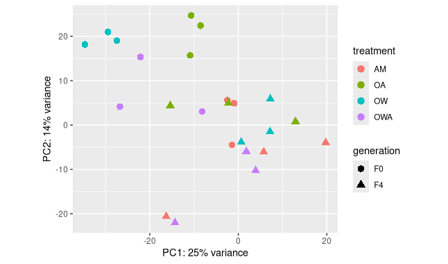

**Notes/Observations**:

-   Higher clustering for F4 treatments

-   F0 ambient clustering closer to F4

**Next steps:**

-   Create Volcano and Euler plots for analysis

------------------------------------------------------------------------

## 10.11.2026 - Euler Plotting for HW 1

-   Create Euler Plot for generations 0 and 4 showing DEGs for each treatment

**Working Directory:**

`~/projects/eco_genomics_2026/transcriptomics/mydata`

**Input Files**:

`salmon.isoform.counts.matrix.filteredAssembly`

**Output Files**:

`None`

**Programs and dependencies**:

-   `R version tidyverse 4.5.1`

-   `R-Studio`

**Scripts**:

`Homework_1.R`

**Code**:

```{r}
# Comparing DEGs between generations of each treatment

# For OW vs AM
# make a list of significant differentially expressed genes for this contrast

# pull out the results for the contrast of interest
res_OWvsAM_F0 <- results(
  dds_F0, name="treatment_OW_vs_AM", 
  alpha=0.05
)
res_OWvsAM_F0 <- res_OWvsAM_F0[order(res_OWvsAM_F0$padj),] # order them by significance
res_OWvsAM_F0 <- res_OWvsAM_F0[!is.na(res_OWvsAM_F0$padj),] # get rid of any NAs

# make a list of significant differentially expressed genes for this contrast
degs_OWvsAM_F0 <- row.names(res_OWvsAM_F0[res_OWvsAM_F0$padj < 0.05,]) 

#F4
res_OWvsAM_F4 <- results(dds_F4, name="treatment_OW_vs_AM", alpha=0.05)
res_OWvsAM_F4 <- res_OWvsAM_F4[order(res_OWvsAM_F4$padj),]
res_OWvsAM_F4 <- res_OWvsAM_F4[!is.na(res_OWvsAM_F4$padj),]
degs_OWvsAM_F4 <- row.names(res_OWvsAM_F4[res_OWvsAM_F4$padj < 0.05,])

### For OA vs AM
# F0
res_OAvsAM_F0 <- results(dds_F0, name="treatment_OA_vs_AM", alpha=0.05)
res_OAvsAM_F0 <- res_OAvsAM_F0[order(res_OAvsAM_F0$padj),]
res_OAvsAM_F0 <- res_OAvsAM_F0[!is.na(res_OAvsAM_F0$padj),]
degs_OAvsAM_F0 <- row.names(res_OAvsAM_F0[res_OAvsAM_F0$padj < 0.05,])
#F4
res_OAvsAM_F4 <- results(dds_F4, name="treatment_OA_vs_AM", alpha=0.05)
res_OAvsAM_F4 <- res_OAvsAM_F4[order(res_OAvsAM_F4$padj),]
res_OAvsAM_F4 <- res_OAvsAM_F4[!is.na(res_OAvsAM_F4$padj),]
degs_OAvsAM_F4 <- row.names(res_OAvsAM_F4[res_OAvsAM_F4$padj < 0.05,])

# For OWA vs AM
#F0
res_OWAvsAM_F0 <- results(dds_F0, name="treatment_OWA_vs_AM", alpha=0.05)
res_OWAvsAM_F0 <- res_OWAvsAM_F0[order(res_OWAvsAM_F0$padj),]
res_OWAvsAM_F0 <- res_OWAvsAM_F0[!is.na(res_OWAvsAM_F0$padj),]
degs_OWAvsAM_F0 <- row.names(res_OWAvsAM_F0[res_OWAvsAM_F0$padj < 0.05,])
#F4
res_OWAvsAM_F4 <- results(dds_F4, name="treatment_OWA_vs_AM", alpha=0.05)
res_OWAvsAM_F4 <- res_OWAvsAM_F4[order(res_OWAvsAM_F4$padj),]
res_OWAvsAM_F4 <- res_OWAvsAM_F4[!is.na(res_OWAvsAM_F4$padj),]
degs_OWAvsAM_F4 <- row.names(res_OWAvsAM_F4[res_OWAvsAM_F4$padj < 0.05,])

library(eulerr)

# Total
length(degs_OAvsAM_F0)  # 602
length(degs_OAvsAM_F4)  # 157
length(degs_OWvsAM_F0)  # 5517 
length(degs_OWvsAM_F4)  # 153
length(degs_OWAvsAM_F0)  # 3918
length(degs_OWAvsAM_F4)  # 241

# Intersections
length(intersect(degs_OAvsAM_F0,degs_OWvsAM_F0))  # 444
length(intersect(degs_OAvsAM_F4,degs_OWvsAM_F4))  # 58
length(intersect(degs_OAvsAM_F0,degs_OWAvsAM_F0))  # 380
length(intersect(degs_OAvsAM_F4,degs_OWAvsAM_F4))  # 41
length(intersect(degs_OWAvsAM_F0,degs_OWvsAM_F0))  # 2743
length(intersect(degs_OWAvsAM_F4,degs_OWvsAM_F4))  # 44

# Shared across all
intWA_F0 <- intersect(degs_OAvsAM_F0,degs_OWvsAM_F0)
length(intersect(degs_OWAvsAM_F0,intWA_F0)) # 338
intWA_F4 <- intersect(degs_OAvsAM_F4,degs_OWvsAM_F4)
length(intersect(degs_OWAvsAM_F4,intWA_F4)) # 18

# Number unique to each treatment
# OA F0
602-444-380+338 # 116 
# OW F0
5517-444-2743+338 # 2668
# OWA F0
3918-380-2743+338 # 1133 

# OA F4
157-58-41+18 # 76 
# OW F4
153-58-44+18 # 69
# OWA F4
241-41-44+18 # 174 

# Number shared in pairs of treatments
# OA & OW F0
444-338 # 106 
# OA & OWA F0
380-338 # 42 
# OWA & OW F0
2743-338 # 2405

# OA & OW F4
58-18 # 40
# OA & OWA F4
41-18 # 23
# OWA & OW F4
44-18 # 26

# Making the plot

fit1 <- euler(
  c(
    "OA" = 116, 
    "OW" = 2668, 
    "OWA" = 1133, 
    "OA&OW" = 106, 
    "OA&OWA" = 42, 
    "OW&OWA" = 2405, 
    "OA&OW&OWA" = 338
  )
)

F0_euler <- plot(
  fit1,  
  quantities = TRUE,  
  fill = list(fill = c("gold","orangered", "sienna1", alpha = 0.5)),
  legend = list(labels = c("OA", "OW", "OWA"))
)

fit2 <- euler(
  c(
    "OA" = 76, 
    "OW" = 69, 
    "OWA" = 174, 
    "OA&OW" = 40, 
    "OA&OWA" = 23, 
    "OW&OWA" = 26, 
    "OA&OW&OWA" = 18
  )
)

F4_euler <- plot(
  fit2,  
  quantities = TRUE,  
  fill = list(fill = c("magenta","darkorchid1", "violetred", alpha = 0.5)),
  legend = list(labels = c("OA", "OW", "OWA"))
)

F0_euler
F4_euler
```

**Images:**

Figure 1. Euler Plot for DEGs of 3 treatments in F0


Figure 2. Euler Plot for DEGs in 3 treatments of F4


**Notes/Observations**:

-   F0

    -   OA has least proportion of DEGs

    -   OW and OWA share many DEGs

    -   338 DEGs shared between all treatments

-   F4

    -   OWA has highest proportion of DEGs

    -   More even distribution than F0

    -   Only 18 DEGs shared

**Next steps:**

-   Create Volcano plots

------------------------------------------------------------------------

## 10.12.2026 - Volcano Plotting for HW 1

-   Create Volcano plot for each treatment (OW, OA, OWA) for both generations (F0 and F4)

**Working Directory:**

`~/projects/eco_genomics_2026/transcriptomics/mydata`

**Input Files**:

`salmon.isoform.counts.matrix.filteredAssembly`

**Output Files**:

`None`

**Programs and dependencies**:

-   `R version tidyverse 4.5.1`

-   `R-Studio`

**Scripts**:

`Homework_1.R`

**Code**:

```{r}
#OW F0

volcano_df <- as.data.frame(res_OWvsAM_F0)

volcano_df <- volcano_df %>%
  mutate(
    sig = case_when(
      padj < 0.05 & log2FoldChange > 1  ~ "Up",
      padj < 0.05 & log2FoldChange < -1 ~ "Down",
      TRUE ~ "NS"
    )
  )
#Number of down/up-regulated genes for OW F0
table(volcano_df$sig) 
#Down    NS    Up 
#258 22317  2173 

F0_OW_Volcano <- ggplot(volcano_df,
       aes(x = log2FoldChange,
           y = -log10(padj),
           color = sig)) +
  geom_point(alpha = 0.6, size = 1.5) +
  scale_color_manual(values = c(
    "Down" = "turquoise4",
    "NS"   = "grey70",
    "Up"   = "orangered"
  )) +
  geom_vline(xintercept = c(-1, 1),
             linetype = "dashed") +
  geom_hline(yintercept = -log10(0.05),
             linetype = "dashed") +
  theme_classic(base_size = 14) +
  labs(
    title = "F0",
    x = "Log2 Fold Change",
    y = "Log10 Adjusted P-value",
    color = NULL
  ) +
  theme(
    plot.title = element_text(hjust = 0.5)
  )


#OA F0
volcano_df <- as.data.frame(res_OAvsAM_F0)

volcano_df <- volcano_df %>%
  mutate(
    sig = case_when(
      padj < 0.05 & log2FoldChange > 1  ~ "Up",
      padj < 0.05 & log2FoldChange < -1 ~ "Down",
      TRUE ~ "NS"
    )
  )
#Number of down/up-regulated genes for OA F0
table(volcano_df$sig) 
#Down    NS    Up 
#99 21391   320 

F0_OA_Volcano <- ggplot(volcano_df,
       aes(x = log2FoldChange,
           y = -log10(padj),
           color = sig)) +
  geom_point(alpha = 0.6, size = 1.5) +
  scale_color_manual(values = c(
    "Down" = "turquoise4",
    "NS"   = "grey70",
    "Up"   = "orangered"
  )) +
  geom_vline(xintercept = c(-1, 1),
             linetype = "dashed") +
  geom_hline(yintercept = -log10(0.05),
             linetype = "dashed") +
  theme_classic(base_size = 14) +
  labs(
    x = "Log2 Fold Change",
    y = "-Log10 Adjusted P-value",
    color = NULL
  )

#OWA F0

volcano_df <- as.data.frame(res_OWAvsAM_F0)

volcano_df <- volcano_df %>%
  mutate(
    sig = case_when(
      padj < 0.05 & log2FoldChange > 1  ~ "Up",
      padj < 0.05 & log2FoldChange < -1 ~ "Down",
      TRUE ~ "NS"
    )
  )

#Number of down/up-regulated genes for OWA F0
table(volcano_df$sig) 
# Down    NS    Up 
#280 22643  1336 

F0_OWA_Volcano <- ggplot(volcano_df,
       aes(x = log2FoldChange,
           y = -log10(padj),
           color = sig)) +
  geom_point(alpha = 0.6, size = 1.5) +
  scale_color_manual(values = c(
    "Down" = "turquoise4",
    "NS"   = "grey70",
    "Up"   = "orangered"
  )) +
  geom_vline(xintercept = c(-1, 1),
             linetype = "dashed") +
  geom_hline(yintercept = -log10(0.05),
             linetype = "dashed") +
  theme_classic(base_size = 14) +
  labs(
    x = "Log2 Fold Change",
    y = "-Log10 Adjusted P-value",
    color = NULL
  )

#OW F4

volcano_df <- as.data.frame(res_OWvsAM_F4)

volcano_df <- volcano_df %>%
  mutate(
    sig = case_when(
      padj < 0.05 & log2FoldChange > 1  ~ "Up",
      padj < 0.05 & log2FoldChange < -1 ~ "Down",
      TRUE ~ "NS"
    )
  )

#Number of down/up-regulated genes for OW F4
table(volcano_df$sig) 
#Down    NS    Up 
#18 22731    50

F4_OW_Volcano <- ggplot(volcano_df,
       aes(x = log2FoldChange,
           y = -log10(padj),
           color = sig)) +
  geom_point(alpha = 0.6, size = 1.5) +
  scale_color_manual(values = c(
    "Down" = "turquoise4",
    "NS"   = "grey70",
    "Up"   = "orangered"
  )) +
  geom_vline(xintercept = c(-1, 1),
             linetype = "dashed") +
  geom_hline(yintercept = -log10(0.05),
             linetype = "dashed") +
  theme_classic(base_size = 14) +
  labs(
    title ="F4",
    x = "Log2 Fold Change",
    y = "-Log10 Adjusted P-value",
    color = NULL
  ) +
  theme(
    plot.title = element_text(hjust = 0.5)
  )

#OA F4

volcano_df <- as.data.frame(res_OAvsAM_F4)

volcano_df <- volcano_df %>%
  mutate(
    sig = case_when(
      padj < 0.05 & log2FoldChange > 1  ~ "Up",
      padj < 0.05 & log2FoldChange < -1 ~ "Down",
      TRUE ~ "NS"
    )
  )

#Number of down/up-regulated genes for OA F4
table(volcano_df$sig)
# Down    NS    Up 
#24 21739    56 

F4_OA_Volcano <- ggplot(volcano_df,
       aes(x = log2FoldChange,
           y = -log10(padj),
           color = sig)) +
  geom_point(alpha = 0.6, size = 1.5) +
  scale_color_manual(values = c(
    "Down" = "turquoise4",
    "NS"   = "grey70",
    "Up"   = "orangered"
  )) +
  geom_vline(xintercept = c(-1, 1),
             linetype = "dashed") +
  geom_hline(yintercept = -log10(0.05),
             linetype = "dashed") +
  theme_classic(base_size = 14) +
  labs(
    x = "Log2 Fold Change",
    y = "-Log10 Adjusted P-value",
    color = NULL
  )

#OWA F4

volcano_df <- as.data.frame(res_OWAvsAM_F4)

volcano_df <- volcano_df %>%
  mutate(
    sig = case_when(
      padj < 0.05 & log2FoldChange > 1  ~ "Up",
      padj < 0.05 & log2FoldChange < -1 ~ "Down",
      TRUE ~ "NS"
    )
  )

#Number of down/up-regulated genes for OWA F4
table(volcano_df$sig)
# Down    NS    Up 
#59 24139    70 

F4_OWA_Volcano <- ggplot(volcano_df,
       aes(x = log2FoldChange,
           y = -log10(padj),
           color = sig)) +
  geom_point(alpha = 0.6, size = 1.5) +
  scale_color_manual(values = c(
    "Down" = "turquoise4",
    "NS"   = "grey70",
    "Up"   = "orangered"
  )) +
  geom_vline(xintercept = c(-1, 1),
             linetype = "dashed") +
  geom_hline(yintercept = -log10(0.05),
             linetype = "dashed") +
  theme_classic(base_size = 14) +
  labs(
    x = "Log2 Fold Change",
    y = "-Log10 Adjusted P-value",
    color = NULL
  )

F0_OW_Volcano
F0_OA_Volcano
F0_OWA_Volcano

F4_OW_Volcano
F4_OA_Volcano
F4_OWA_Volcano


#Combine using patchwork
combined_volcano <-(F0_OW_Volcano | F4_OW_Volcano) /
  (F0_OA_Volcano | F4_OA_Volcano) /
  (F0_OWA_Volcano | F4_OWA_Volcano) +
  plot_annotation(
    tag_levels = 'A') +
  plot_layout(
    guides = "collect",
    axis_titles = "collect"
  ) &
  theme(
    plot.tag = element_text(size = 15),
    legend.position = "right"
  )
  
combined_volcano

```

**Images:**

Figure 1. Volcano plots for OW(top), OA(middle) and, OWA(bottom) for generations F0 (left) and F4 (right).

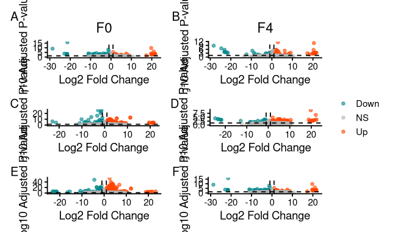

**Notes/Observations**:

-   OW in F0 showed the greatest number of up-regulated genes
-   OWA in F0 showed the greatest number of down regulated genes
-   Generation 4 showed greater changes in gene regulation than gen 0

**Next steps:**

-   Write up results
